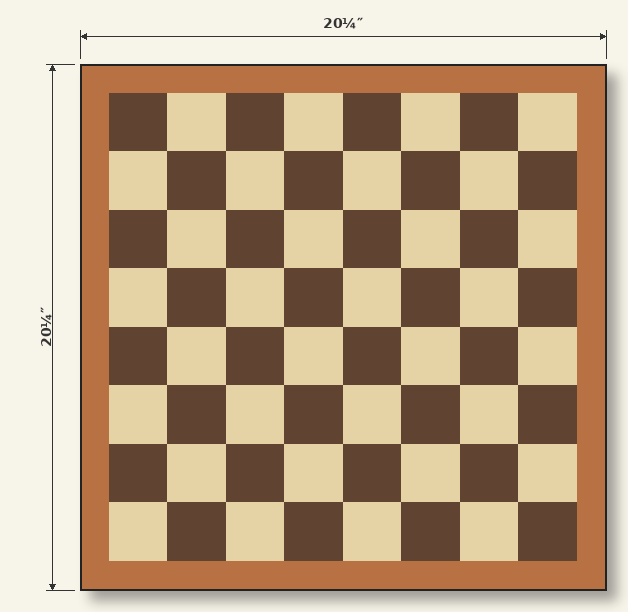
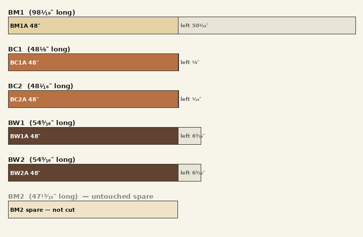
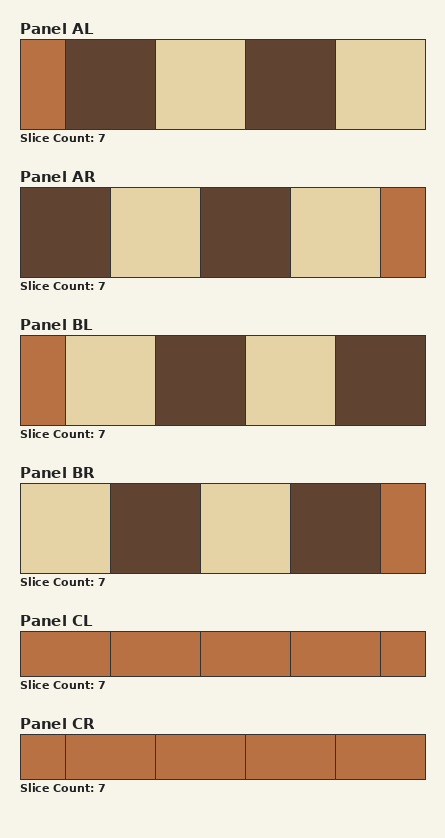
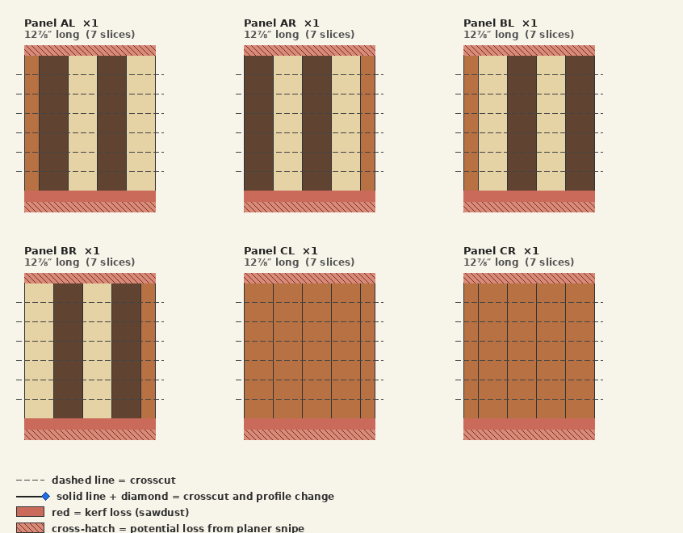
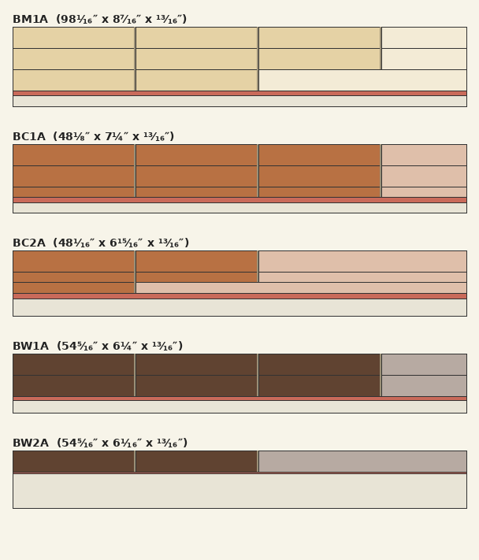
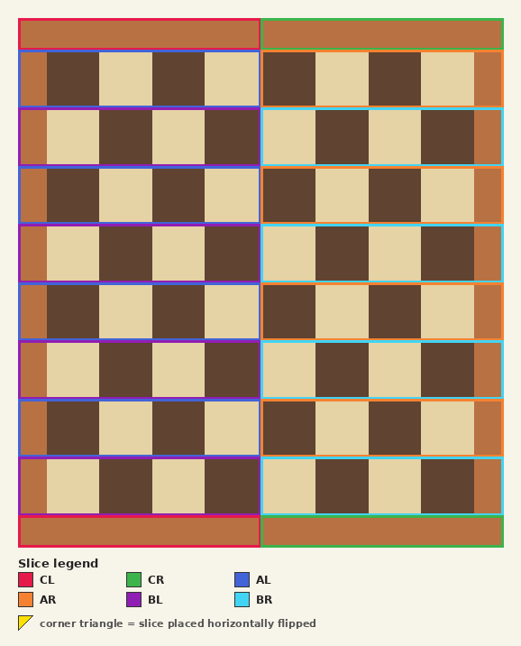

# Chess v1 — Cut Plan

*One end-grain chess-pattern board, walnut and brown maple 2.25 in cells, cherry border 1.125 in all sides, finished 20.25 in square, 0.5 in thick. Each row is built as two half-width panels split at the centre line (left half mirrors right half), so no panel is wider than 10.125 in and every panel fits the 12.5 in planer.*

This is a generated plan: the finished design and the cut list that realizes it on the boards in hand. Where the cut list cannot be met from inventory it calls for **bought boards** — buy those and re-run before cutting. The sections follow the build order, from the first crosscut to the final slice-grid assembly.

## 1. Finished board pattern

## 2. Volume Sanity Check

A per-species feasibility check in board feet (1 BF = 144 cubic inches). **Required** is the surfaced volume of every installed slice across all 1 board(s) plus the volume that must be removed to produce them — flattening (sliceDepth − finishedThickness), planing all four edges (minPlaneLoss), and one miter kerf per slice. **Available** is the inventory stock volume. **Volume Offset** = available − required, with available as a percentage of required in parentheses (100% means they are equal); a negative value means the project cannot be built from stock in hand.

| Species | Available | Required | Volume Offset |
| --- | --- | --- | --- |
| maple | 6.9 BF | 0.6 BF + 1.5 BF loss = 2.0 BF | +4.9 BF (342%) |
| cherry | 3.9 BF | 0.3 BF + 0.8 BF loss = 1.1 BF | +2.7 BF (343%) |
| walnut | 3.8 BF | 0.6 BF + 1.5 BF loss = 2.0 BF | +1.8 BF (187%) |

## 3. Crosscut Blanks

The first operation: crosscut each raw inventory board along its length into the labeled board blanks that get ripped later (the Initial board rips section). Boards that start from another board's leftover margin are not raw-stock crosscuts — they appear as the labeled offcuts in the Board Rip Diagram.

| Raw board | Species | Raw length | Blanks (id = length) | Leftover |
| --- | --- | --- | --- | --- |
| BM1 | maple | 98¹⁄₁₆″ | BM1A = 48″ | 50¹⁄₁₆″ |
| BC1 | cherry | 48⅛″ | BC1A = 48″ | ⅛″ |
| BC2 | cherry | 48¹⁄₁₆″ | BC2A = 48″ | ¹⁄₁₆″ |
| BW1 | walnut | 54⁵⁄₁₆″ | BW1A = 48″ | 6⁵⁄₁₆″ |
| BW2 | walnut | 54⁵⁄₁₆″ | BW2A = 48″ | 6⁵⁄₁₆″ |
| BM2 | maple | 47¹⁵⁄₁₆″ | — (untouched spare) | — |

### Crosscut Diagram

Each bar is one raw board drawn to scale by length; segments are the blanks (labeled with id and length inside), reddish stripes are crosscut kerfs (sawdust), and the pale tail is leftover length. A red tail means the blanks overflow the raw board. An untouched spare is shown washed-out and uncut; a board used whole goes straight to the rip diagram.

## 4. Panels overview

| Panel | Qty | Length | Slices | Height | Ripped | Sequence (outer → in) |
| --- | --- | --- | --- | --- | --- | --- |
| AL | 1 | 12⅞″ | 7 | 2¼″ | — | CB · W · M · W · M |
| AR | 1 | 12⅞″ | 7 | 2¼″ | — | W · M · W · M · CB |
| BL | 1 | 12⅞″ | 7 | 2¼″ | — | CB · M · W · M · W |
| BR | 1 | 12⅞″ | 7 | 2¼″ | — | M · W · M · W · CB |
| CL | 1 | 12⅞″ | 7 | 1⅛″ | — | CT · CT · CT · CT · CTH |
| CR | 1 | 12⅞″ | 7 | 1⅛″ | — | CTH · CT · CT · CT · CT |

### Panel End Grain Diagram

Each panel's end-grain cross-section (the glue-up of component stripes).

### Panel Face Diagram

Each panel drawn to scale with its length running top-to-bottom. Components are vertical stripes aligned on the squared edge; profile regions stack down the length, so the silhouette steps narrower where trailing components drop out. Dashed lines are the slice crosscuts; the solid red band is total kerf loss, and the cross-hatched ends are the snipe tails (possible loss, depending on the planer).

### Slice Fulfillment

**Demand** is every slice the grid places across all 1 finished board(s). **Supplied** is the slices the panels above produce — snipe lost, ripped panels multiplied by their strip count. **Supply Offset** = supplied − demand: negative is a shortfall, positive is extra (ideally non-negative everywhere).

| Slice | Demand | Supplied | Supply Offset |
| --- | --- | --- | --- |
| CL | 2 × 1 = 2 | 7 | +5 |
| CR | 2 × 1 = 2 | 7 | +5 |
| AL | 4 × 1 = 4 | 7 | +3 |
| AR | 4 × 1 = 4 | 7 | +3 |
| BL | 4 × 1 = 4 | 7 | +3 |
| BR | 4 × 1 = 4 | 7 | +3 |

_The slice counts supplied are calculated assuming the panels and their quantities are delivered perfectly according to the specs in this section. A panel type may have more than one instance; the ideal panels are always quantity 1._

## 5. Initial board rips (the cut list)

Each row is one physical board at the saw: rip the strips down its width, then crosscut each strip to the piece lengths. The **Board** column shows `id @ width` — the board's width when ripping begins. **Used** is the summed strip width, **Loss** is rip kerf + planer cleanup per strip, **Margin** is the leftover width (negative = the strips do not fit; large = the board is oversized for what it yields).

| Board | Origin | Species | Length | Rips (width × count) | Used | Loss | Margin |
| --- | --- | --- | --- | --- | --- | --- | --- |
| BM1A @ 8⁷⁄₁₆″ | BM1 | maple | 48″ | 2¼″ ×3 | 6¾″ | ⁹⁄₁₆″ | 1⅛″ |
| BC1A @ 7¼″ | BC1 | cherry | 48″ | 2¼″ ×2 · 1⅛″ ×1 | 5⅝″ | ⁹⁄₁₆″ | 1¹⁄₁₆″ |
| BC2A @ 6¹⁵⁄₁₆″ | BC2 | cherry | 48″ | 2¼″ ×1 · 1⅛″ ×2 | 4½″ | ⁹⁄₁₆″ | 1⅞″ |
| BW1A @ 6¼″ | BW1 | walnut | 48″ | 2¼″ ×2 | 4½″ | ⅜″ | 1⅜″ |
| BW2A @ 6¹⁄₁₆″ | BW2 | walnut | 48″ | 2¼″ ×1 | 2¼″ | ³⁄₁₆″ | 3⅝″ |

### Board Rip Diagram

Each labeled block below is one physical board. Horizontal bands are the strips ripped down the board's width; within a band, the colored cells are the crosscut pieces (with thin kerf gaps between them) and the lightened tail is the offcut. The pale band under the strips is the leftover margin; a gray title marks a board that must be bought.

## 6. Components

**Demand** is what the finished pattern needs (counted from the slice grid; length is the panel the component belongs to). **Fulfilled** is how many the cut list supplies, matched longest-demand-first using exact-length pieces first, then longer pieces cut down (a piece shorter than the demand cannot be used). **Shortfall** is the unmet count. **Total Overcut** is the wasted length trimmed off — the sum of (piece length − demand length) across every longer piece that had to be cut down to fill this row (0 when exact-length pieces covered it).

| Component | Species | Width | Length | Demand | Fulfilled | Shortfall |
| --- | --- | --- | --- | --- | --- | --- |
| CB | cherry | 1⅛″ | 12⅞″ | 4 | 4 | 0 |
| CT | cherry | 2¼″ | 12⅞″ | 8 | 8 | 0 |
| CTH | cherry | 1⅛″ | 12⅞″ | 2 | 2 | 0 |
| M | maple | 2¼″ | 12⅞″ | 8 | 8 | 0 |
| W | walnut | 2¼″ | 12⅞″ | 8 | 8 | 0 |

## 7. Panels (profiles and sequence)

The physical panels this plan builds (from the project's panel specs), grouped by identical shape. Qty is how many of each to glue up.

| Panel | Qty | Length | Profiles (slices) | Component sequence |
| --- | --- | --- | --- | --- |
| AL | 1 | 12⅞″ | single: 7 | CB · W · M · W · M |
| AR | 1 | 12⅞″ | single: 7 | W · M · W · M · CB |
| BL | 1 | 12⅞″ | single: 7 | CB · M · W · M · W |
| BR | 1 | 12⅞″ | single: 7 | M · W · M · W · CB |
| CL | 1 | 12⅞″ | single: 7 | CT · CT · CT · CT · CTH |
| CR | 1 | 12⅞″ | single: 7 | CTH · CT · CT · CT · CT |

## 8. Slice Grid

The final step: arrange the slices into the finished face. The same grid keyed by slice id — each slice is framed in its legend color so you can see how to arrange the grid cell by cell. A corner triangle marks a slice placed horizontally flipped.

