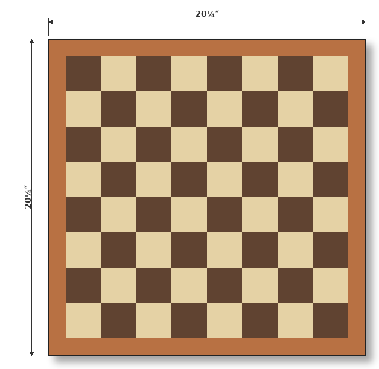
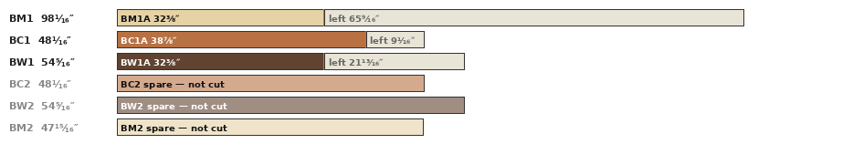
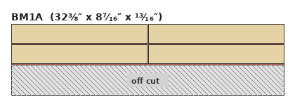
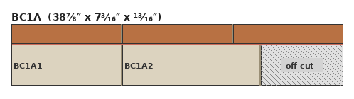
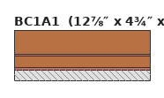
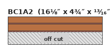
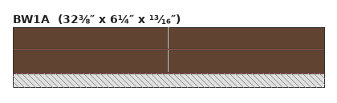
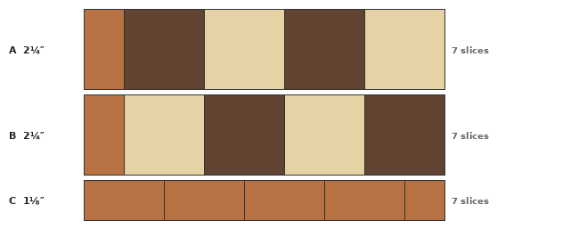
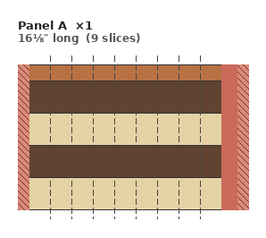

# Chess v1 — Cut Plan

*One end-grain chess-pattern board, walnut and brown maple 2.25 in cells, cherry border 1.125 in all sides, finished 20.25 in square, 0.5 in thick. Each row is built as two half-width panels split at the centre line (left half mirrors right half), so no panel is wider than 10.125 in and every panel fits the 12.5 in planer. Only three panel patterns are built, A, B and C, and both A and B start with a cherry component. Their mirrors are the same slices placed flipped (flip H), A flipped covers the old BR half, B flipped covers the old AR half, C flipped covers the old CR half.*

Cut list for the finished design, in build order.

## 1. Warnings

| # | Lvl | Type | Message |
| --- | --- | --- | --- |
| 1 | WARNING | Zero Offcut | 9 strip(s) crosscut to an exact fit with 0″ offcut — no margin for cutting error in the crosscut phase: BM1A ×2, BC1A ×1, BC1A1 ×2, BC1A2 ×2, BW1A ×2. A cut even slightly long, or kerf drift, will make the last piece short. Consider longer blanks or fewer pieces per strip. |

## 2. Finished board pattern

## 3. Volume Sanity Check

Review the per-species volumes against inventory.

| Species | Available | Required | Volume Offset |
| --- | --- | --- | --- |
| maple | 6.9 BF | 0.6 BF + 1.5 BF loss = 2.0 BF | +4.9 BF (342%) |
| cherry | 3.7 BF | 0.3 BF + 0.8 BF loss = 1.1 BF | +2.6 BF (330%) |
| walnut | 3.8 BF | 0.6 BF + 1.5 BF loss = 2.0 BF | +1.8 BF (187%) |

## 4. Crosscut Blanks

This plan involves cutting blanks from the inventory — review the inventory and the planned cuts.

| Raw board | Species | Raw length | Blanks (id = length) | Leftover |
| --- | --- | --- | --- | --- |
| BM1 | maple | 98¹⁄₁₆″ | BM1A = 32⅜″ | 65⁹⁄₁₆″ |
| BC1 | cherry | 48¹⁄₁₆″ | BC1A = 38⅞″ | 9¹⁄₁₆″ |
| BW1 | walnut | 54⁵⁄₁₆″ | BW1A = 32⅜″ | 21¹³⁄₁₆″ |
| BC2 | cherry | 48¹⁄₁₆″ | — (untouched spare) | — |
| BW2 | walnut | 54⁵⁄₁₆″ | — (untouched spare) | — |
| BM2 | maple | 47¹⁵⁄₁₆″ | — (untouched spare) | — |

### Crosscut Diagram

## 5. Initial board rips (the cut list)

Review the rip list.

| Board | Origin | Species | Length | Rips (width × count) | Used | Loss | Margin |
| --- | --- | --- | --- | --- | --- | --- | --- |
| BM1A @ 8⁷⁄₁₆″ | BM1 | maple | 32⅜″ | 2¼″ ×2 | 4½″ | ⅜″ | 3⁹⁄₁₆″ |
| BC1A @ 7³⁄₁₆″ | BC1 | cherry | 38⅞″ | 2¼″ ×1 | 2¼″ | ³⁄₁₆″ | 4¾″ |
| ↳ margin crosscuts | remainder of BC1A | cherry | 29¼″ | BC1A1 = 12⅞″; BC1A2 = 16⅛″ | 29″ | ¼″ | 9⅝″ |
| BC1A1 @ 4¾″ | remainder of BC1A | cherry | 12⅞″ | 2¼″ ×1 · 1⅛″ ×1 | 3⅜″ | ⅜″ | 1″ |
| BC1A2 @ 4¾″ | remainder of BC1A | cherry | 16⅛″ | 1⅛″ ×2 | 2¼″ | ⅜″ | 2⅛″ |
| BW1A @ 6¼″ | BW1 | walnut | 32⅜″ | 2¼″ ×2 | 4½″ | ⅜″ | 1⅜″ |

### Board Rip Diagram

Review the board rip diagrams against the rip list.

## 6. Panels overview

| Panel | Qty | Length | Slices | Height | Ripped | Sequence (outer → in) |
| --- | --- | --- | --- | --- | --- | --- |
| A | 1 | 16⅛″ | 9 | 2¼″ | — | CB · W · M · W · M |
| B | 1 | 16⅛″ | 9 | 2¼″ | — | CB · M · W · M · W |
| C | 1 | 12⅞″ | 7 | 1⅛″ | — | CT · CT · CT · CT · CTH |

### Panel End Grain Diagram

Review the panel end-grain diagrams.

### Panel Face Diagram

Review the panel face diagrams.

### Slice Fulfillment

Review slice demand, supply, and offset.

| Slice | Demand | Supplied | Supply Offset |
| --- | --- | --- | --- |
| C | 4 × 1 = 4 | 7 | +3 |
| A | 8 × 1 = 8 | 9 | +1 |
| B | 8 × 1 = 8 | 9 | +1 |

## 7. Components

Review component demand, fulfillment, and shortfall.

| Component | Species | Width | Length | Demand | Fulfilled | Shortfall |
| --- | --- | --- | --- | --- | --- | --- |
| CB | cherry | 1⅛″ | 16⅛″ | 2 | 2 | 0 |
| CT | cherry | 2¼″ | 12⅞″ | 4 | 4 | 0 |
| CTH | cherry | 1⅛″ | 12⅞″ | 1 | 1 | 0 |
| M | maple | 2¼″ | 16⅛″ | 4 | 4 | 0 |
| W | walnut | 2¼″ | 16⅛″ | 4 | 4 | 0 |

## 8. Panels (profiles and sequence)

Review the panels and their quantities.

| Panel | Qty | Length | Profiles (slices) | Component sequence |
| --- | --- | --- | --- | --- |
| A | 1 | 16⅛″ | single: 9 | CB · W · M · W · M |
| B | 1 | 16⅛″ | single: 9 | CB · M · W · M · W |
| C | 1 | 12⅞″ | single: 7 | CT · CT · CT · CT · CTH |
