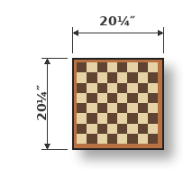
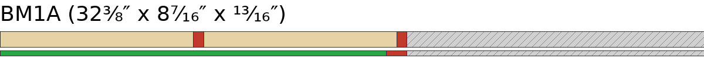
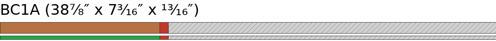
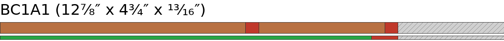
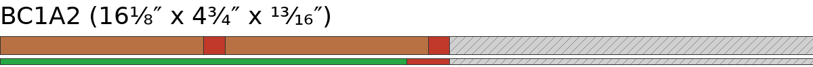
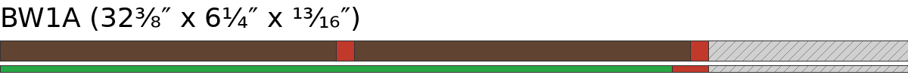
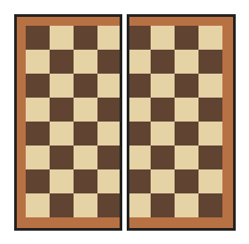

# Chess v1 — Plan Checklist (solver, actual)

## Phase 1 — Initial crosscuts

| [ ] | Raw board | Species | Blank | Length | Off Cut |
| --- | --- | --- | --- | --- | --- |
| [ ] | BM1 (98¹⁄₁₆″) | Brown Maple | BM1A | 32⅜″ | 65⁹⁄₁₆″ |
| [ ] | BC1 (48¹⁄₁₆″) | Cherry | BC1A | 38⅞″ | 9¹⁄₁₆″ |
| [ ] | BW1 (54⁵⁄₁₆″) | Walnut | BW1A | 32⅜″ | 21¹³⁄₁₆″ |

Spare — do not cut: BC2 (Cherry, 48¹⁄₁₆″), BW2 (Walnut, 54⁵⁄₁₆″), BM2 (Brown Maple, 47¹⁵⁄₁₆″).

## Phase 2 — Rips

### Phase 2.1 — BM1A — Brown Maple

| [ ] | Rip | Rip size | Final width | Length | Pieces planned |
| --- | --- | --- | --- | --- | --- |
| [ ] | 1 | 2⁵⁄₁₆″ (2.31″) | 2¼″ (2.25″) | 32⅜″ | 16⅛″x2 |
| [ ] | 2 | 2⁵⁄₁₆″ (2.31″) | 2¼″ (2.25″) | 32⅜″ | 16⅛″x2 |

Board width 8⁷⁄₁₆″ = used 4½″ + loss ⅜″ + margin 3⁹⁄₁₆″.

### Phase 2.2 — BC1A — Cherry

| [ ] | Rip | Rip size | Final width | Length | Pieces planned |
| --- | --- | --- | --- | --- | --- |
| [ ] | 1 | 2⁵⁄₁₆″ (2.31″) | 2¼″ (2.25″) | 38⅞″ | 12⅞″x3 |

Board width 7³⁄₁₆″ = used 2¼″ + loss ³⁄₁₆″ + margin 4¾″.

Margin crosscuts — BC1A margin slab, length 38⅞″:

| [ ] | Child blank | Length |
| --- | --- | --- |
| [ ] | BC1A1 | 12⅞″ |
| [ ] | BC1A2 | 16⅛″ |

Rip the child boards next, in the order above, before the next parent board.

### Phase 2.3 — BC1A1 — Cherry

| [ ] | Rip | Rip size | Final width | Length | Pieces planned |
| --- | --- | --- | --- | --- | --- |
| [ ] | 1 | 2⁵⁄₁₆″ (2.31″) | 2¼″ (2.25″) | 12⅞″ | 12⅞″ |
| [ ] | 2 | 1³⁄₁₆″ (1.19″) | 1⅛″ (1.12″) | 12⅞″ | 12⅞″ |

Board width 4¾″ = used 3⅜″ + loss ⅜″ + margin 1″.

### Phase 2.4 — BC1A2 — Cherry

| [ ] | Rip | Rip size | Final width | Length | Pieces planned |
| --- | --- | --- | --- | --- | --- |
| [ ] | 1 | 1³⁄₁₆″ (1.19″) | 1⅛″ (1.12″) | 16⅛″ | 16⅛″ |
| [ ] | 2 | 1³⁄₁₆″ (1.19″) | 1⅛″ (1.12″) | 16⅛″ | 16⅛″ |

Board width 4¾″ = used 2¼″ + loss ⅜″ + margin 2⅛″.

### Phase 2.5 — BW1A — Walnut

| [ ] | Rip | Rip size | Final width | Length | Pieces planned |
| --- | --- | --- | --- | --- | --- |
| [ ] | 1 | 2⁵⁄₁₆″ (2.31″) | 2¼″ (2.25″) | 32⅜″ | 16⅛″x2 |
| [ ] | 2 | 2⁵⁄₁₆″ (2.31″) | 2¼″ (2.25″) | 32⅜″ | 16⅛″x2 |

Board width 6¼″ = used 4½″ + loss ⅜″ + margin 1⅜″.

## Phase 3 — Plane by width

### Phase 3.1 — Gang — Plane to 2¼″ — planer setting 2¼″ (6 strips) — requires a gang

Requires a gang — tape strips together; total thickness 4⅞″ ≥ 2¼″.

| [ ] | Species | Count |
| --- | --- | --- |
| [ ] | Brown Maple | 2 strips |
| [ ] | Cherry | 2 strips |
| [ ] | Walnut | 2 strips |

### Phase 3.2 — Gang — Plane to 1⅛″ — planer setting 1⅛″ (3 strips) — requires a gang

Requires a gang — tape strips together; total thickness 2⁷⁄₁₆″ ≥ 1⅛″.

| [ ] | Species | Count |
| --- | --- | --- |
| [ ] | Cherry | 3 strips |

## Phase 4 — Crosscut components

### Phase 4.1 — Crosscut grouping — by length

| Length | Species | Final width | Pieces |
| --- | --- | --- | --- |
| 12⅞″ | Cherry | 2¼″ (2.25″) | 4 |
| 12⅞″ | Cherry | 1⅛″ (1.12″) | 1 |
| 16⅛″ | Brown Maple | 2¼″ (2.25″) | 4 |
| 16⅛″ | Cherry | 1⅛″ (1.12″) | 2 |
| 16⅛″ | Walnut | 2¼″ (2.25″) | 4 |

Totals: 12⅞″ ×5, 16⅛″ ×10.

### Phase 4.2 — BM1A — Brown Maple

| Cuts | Strip | Species | Final width | Pieces | Off Cut |
| --- | --- | --- | --- | --- | --- |
| [ ] [ ] | 1 | Brown Maple | 2¼″ (2.25″) | 16⅛″x2 | 0″ ⚠️ |
| [ ] [ ] | 2 | Brown Maple | 2¼″ (2.25″) | 16⅛″x2 | 0″ ⚠️ |

### Phase 4.3 — BC1A — Cherry

| Cuts | Strip | Species | Final width | Pieces | Off Cut |
| --- | --- | --- | --- | --- | --- |
| [ ] [ ] [ ] | 1 | Cherry | 2¼″ (2.25″) | 12⅞″x3 | 0″ ⚠️ |

### Phase 4.4 — BC1A1 — Cherry

| Cuts | Strip | Species | Final width | Pieces | Off Cut |
| --- | --- | --- | --- | --- | --- |
| [ ] | 1 | Cherry | 2¼″ (2.25″) | 12⅞″ | 0″ ⚠️ |
| [ ] | 2 | Cherry | 1⅛″ (1.12″) | 12⅞″ | 0″ ⚠️ |

### Phase 4.5 — BC1A2 — Cherry

| Cuts | Strip | Species | Final width | Pieces | Off Cut |
| --- | --- | --- | --- | --- | --- |
| [ ] | 1 | Cherry | 1⅛″ (1.12″) | 16⅛″ | 0″ ⚠️ |
| [ ] | 2 | Cherry | 1⅛″ (1.12″) | 16⅛″ | 0″ ⚠️ |

### Phase 4.6 — BW1A — Walnut

| Cuts | Strip | Species | Final width | Pieces | Off Cut |
| --- | --- | --- | --- | --- | --- |
| [ ] [ ] | 1 | Walnut | 2¼″ (2.25″) | 16⅛″x2 | 0″ ⚠️ |
| [ ] [ ] | 2 | Walnut | 2¼″ (2.25″) | 16⅛″x2 | 0″ ⚠️ |

Total: 9 strips, 15 component pieces.

## Phase 5 — Panel glue-ups

### Phase 5.1 — Panel A

16⅛″ x 10⅛″ x 2¼″ - 5 components - x1 duplicates

| Panels | Order | Species | Width | Component |
| --- | --- | --- | --- | --- |
| [ ] | 1 | Cherry | 1⅛″ (1.12″) | CB |
| [ ] | 2 | Walnut | 2¼″ (2.25″) | W |
| [ ] | 3 | Brown Maple | 2¼″ (2.25″) | M |
| [ ] | 4 | Walnut | 2¼″ (2.25″) | W |
| [ ] | 5 | Brown Maple | 2¼″ (2.25″) | M |

### Phase 5.2 — Panel B

16⅛″ x 10⅛″ x 2¼″ - 5 components - x1 duplicates

| Panels | Order | Species | Width | Component |
| --- | --- | --- | --- | --- |
| [ ] | 1 | Cherry | 1⅛″ (1.12″) | CB |
| [ ] | 2 | Brown Maple | 2¼″ (2.25″) | M |
| [ ] | 3 | Walnut | 2¼″ (2.25″) | W |
| [ ] | 4 | Brown Maple | 2¼″ (2.25″) | M |
| [ ] | 5 | Walnut | 2¼″ (2.25″) | W |

### Phase 5.3 — Panel C

12⅞″ x 10⅛″ x 1⅛″ - 5 components - x1 duplicates

| Panels | Order | Species | Width | Component |
| --- | --- | --- | --- | --- |
| [ ] | 1 | Cherry | 2¼″ (2.25″) | CT |
| [ ] | 2 | Cherry | 2¼″ (2.25″) | CT |
| [ ] | 3 | Cherry | 2¼″ (2.25″) | CT |
| [ ] | 4 | Cherry | 2¼″ (2.25″) | CT |
| [ ] | 5 | Cherry | 1⅛″ (1.12″) | CTH |

## Phase 6 — Slices

2½″ thick (1½″ after flattening)

| [ ] | Slice | From panel | Slice Count |
| --- | --- | --- | --- |
| [ ] | C | C | 7 x 1 = 7 |
| [ ] | A | A | 9 x 1 = 9 |
| [ ] | B | B | 9 x 1 = 9 |

## Phase 7 — Column Glue Ups

| Board | Column | Slices |
| --- | --- | --- |
| [ ] | Column 1 | 01 [ ] C 02 [ ] A 03 [ ] B 04 [ ] A 05 [ ] B 06 [ ] A 07 [ ] B 08 [ ] A 09 [ ] B 10 [ ] C |
| [ ] | Column 2 | 01 [ ] C* 02 [ ] B* 03 [ ] A* 04 [ ] B* 05 [ ] A* 06 [ ] B* 07 [ ] A* 08 [ ] B* 09 [ ] A* 10 [ ] C* |

## Phase 8 — Final Glue Up

| Board | Columns | Size |
| --- | --- | --- |
| [ ] | Column 1 + Column 2 | 20¼″ × 20¼″ × 1½″ |

## Phase 9 — Finishing

Final dimensions: 20¼″ × 20¼″ × ½″
Edge trims: left 0″, right 0″, top 0″, bottom 0″

| Board | Width trim | Length trim | Flatten | Sanding (grits) | Oil | Wax |
| --- | --- | --- | --- | --- | --- | --- |
| [ ] | 20¼″ → 20¼″ | 20¼″ → 20¼″ | 1½″ → ½″ | [ ] 80 [ ] 120 [ ] 220 [ ] 320 | [ ] | [ ] |
