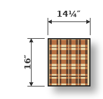
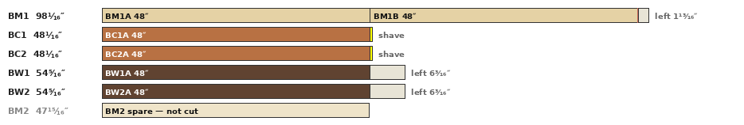
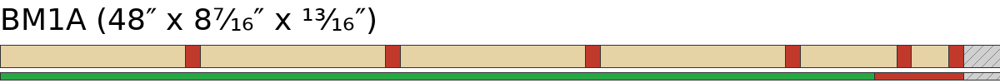
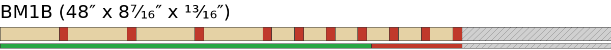
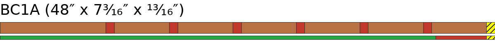
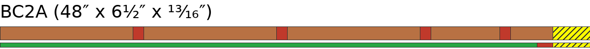
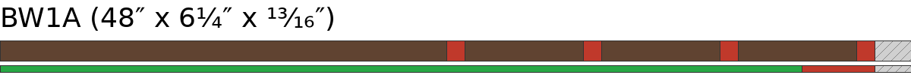
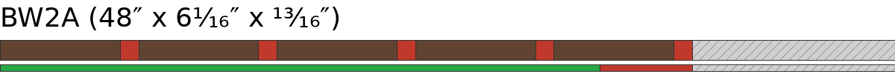
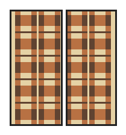

# Plaid v1 — Plan Checklist (hand, actual)

## Phase 1 — Initial crosscuts ⚠️

| [ ] | Raw board | Species | Blank | Length | Off Cut |
| --- | --- | --- | --- | --- | --- |
| [ ] | BM1 (98¹⁄₁₆″) | Brown Maple | BM1A | 48″ | 49¹⁵⁄₁₆″ |
| [ ] | BM1 ↩ | Brown Maple | BM1B | 48″ | 1¹³⁄₁₆″ |
| [ ] | BC1 (48¹⁄₁₆″) | Cherry | BC1A | 48″ | 0″ ⚠️ |
| [ ] | BC2 (48¹⁄₁₆″) | Cherry | BC2A | 48″ | 0″ ⚠️ |
| [ ] | BW1 (54⁵⁄₁₆″) | Walnut | BW1A | 48″ | 6³⁄₁₆″ |
| [ ] | BW2 (54⁵⁄₁₆″) | Walnut | BW2A | 48″ | 6³⁄₁₆″ |

Spare — do not cut: BM2 (Brown Maple, 47¹⁵⁄₁₆″).
**⚠️ WARNING — Board BC1's cut is close to the end of the board, so the saw blade will be shaving off the end with no off cut.**
**⚠️ WARNING — Board BC2's cut is close to the end of the board, so the saw blade will be shaving off the end with no off cut.**

## Phase 2 — Rips

### Phase 2.1 — BM1A — Brown Maple

| [ ] | Rip | Rip size | Final width | Length | Pieces planned | Margin |
| --- | --- | --- | --- | --- | --- | --- |
| [ ] | 1 | 1⁹⁄₁₆″ (1.56″) | 1½″ (1.50″) | 48″ | 19⅜″x2 | 6¾″ |
| [ ] | 2 | 1⁹⁄₁₆″ (1.56″) | 1½″ (1.50″) | 48″ | 19⅜″x2 | 5¹⁄₁₆″ |
| [ ] | 3 | 1⁹⁄₁₆″ (1.56″) | 1½″ (1.50″) | 48″ | 19⅜″x2 | 3⅜″ |
| [ ] | 4 | 1⁹⁄₁₆″ (1.56″) | 1½″ (1.50″) | 48″ | 19⅜″x2 | 1¹¹⁄₁₆″ |
| [ ] | 5 | ¹³⁄₁₆″ (0.81″) | ¾″ (0.75″) | 48″ | 19⅜″x2 | ¾″ |
| [ ] | 6 | ⁵⁄₁₆″ (0.31″) | ¼″ (0.25″) | 48″ | 19⅜″x2 | ⁵⁄₁₆″ |

Board width 8⁷⁄₁₆″ = used 7″ + loss 1⅛″ + margin ⁵⁄₁₆″.

### Phase 2.2 — BM1B — Brown Maple

| [ ] | Rip | Rip size | Final width | Length | Pieces planned | Margin |
| --- | --- | --- | --- | --- | --- | --- |
| [ ] | 1 | ¹³⁄₁₆″ (0.81″) | ¾″ (0.75″) | 48″ | 19⅜″x2 | 7½″ |
| [ ] | 2 | ¹³⁄₁₆″ (0.81″) | ¾″ (0.75″) | 48″ | 19⅜″x2 | 6⁹⁄₁₆″ |
| [ ] | 3 | ¹³⁄₁₆″ (0.81″) | ¾″ (0.75″) | 48″ | 19⅜″x2 | 5⅝″ |
| [ ] | 4 | ¹³⁄₁₆″ (0.81″) | ¾″ (0.75″) | 48″ | 17¾″ | 4¹¹⁄₁₆″ |
| [ ] | 5 | ⁵⁄₁₆″ (0.31″) | ¼″ (0.25″) | 48″ | 19⅜″x2 | 4¼″ |
| [ ] | 6 | ⁵⁄₁₆″ (0.31″) | ¼″ (0.25″) | 48″ | 19⅜″x2 | 3¹³⁄₁₆″ |
| [ ] | 7 | ⁵⁄₁₆″ (0.31″) | ¼″ (0.25″) | 48″ | 19⅜″x2 | 3⅜″ |
| [ ] | 8 | ⁵⁄₁₆″ (0.31″) | ¼″ (0.25″) | 48″ | 19⅜″x2 | 2¹⁵⁄₁₆″ |
| [ ] | 9 | ⁵⁄₁₆″ (0.31″) | ¼″ (0.25″) | 48″ | 19⅜″x2 | 2½″ |
| [ ] | 10 | ⁵⁄₁₆″ (0.31″) | ¼″ (0.25″) | 48″ | 17¾″x2 | 2¹⁄₁₆″ |

Board width 8⁷⁄₁₆″ = used 4½″ + loss 1⅞″ + margin 2¹⁄₁₆″.

### Phase 2.3 — BC1A — Cherry ⚠️

| [ ] | Rip | Rip size | Final width | Length | Pieces planned | Margin |
| --- | --- | --- | --- | --- | --- | --- |
| [ ] | 1 | 1⁹⁄₁₆″ (1.56″) | 1½″ (1.50″) | 48″ | 19⅜″x2 | 5½″ |
| [ ] | 2 | ¹³⁄₁₆″ (0.81″) | ¾″ (0.75″) | 48″ | 19⅜″x2 | 4⁹⁄₁₆″ |
| [ ] | 3 | ¹³⁄₁₆″ (0.81″) | ¾″ (0.75″) | 48″ | 19⅜″x2 | 3⅝″ |
| [ ] | 4 | ¹³⁄₁₆″ (0.81″) | ¾″ (0.75″) | 48″ | 19⅜″x2 | 2¹¹⁄₁₆″ |
| [ ] | 5 | ¹³⁄₁₆″ (0.81″) | ¾″ (0.75″) | 48″ | 19⅜″x2 | 1¾″ |
| [ ] | 6 | ¹³⁄₁₆″ (0.81″) | ¾″ (0.75″) | 48″ | 19⅜″x2 | ¹³⁄₁₆″ |
| [ ] | 7 | ¹³⁄₁₆″ (0.81″) | ¾″ (0.75″) | 48″ | 19⅜″x2 | -⅛″ ⚠️ |

Board width 7³⁄₁₆″ = used 6″ + loss 1⁵⁄₁₆″ + margin -⅛″ ⚠️.
**⚠️ ERROR — Over-rip: Cut list for board BC1A over-rips by ⅛″: the strips are wider than the board.**

### Phase 2.4 — BC2A — Cherry ⚠️

| [ ] | Rip | Rip size | Final width | Length | Pieces planned | Margin |
| --- | --- | --- | --- | --- | --- | --- |
| [ ] | 1 | 1⁹⁄₁₆″ (1.56″) | 1½″ (1.50″) | 48″ | 19⅜″x2 | 4¹³⁄₁₆″ |
| [ ] | 2 | 1⁹⁄₁₆″ (1.56″) | 1½″ (1.50″) | 48″ | 19⅜″x2 | 3⅛″ |
| [ ] | 3 | 1⁹⁄₁₆″ (1.56″) | 1½″ (1.50″) | 48″ | 19⅜″x2 | 1⁷⁄₁₆″ |
| [ ] | 4 | ¹³⁄₁₆″ (0.81″) | ¾″ (0.75″) | 48″ | 19⅜″x2 | ½″ |
| [ ] | 5 | ¹³⁄₁₆″ (0.81″) | ¾″ (0.75″) | 48″ | 19⅜″x2 | -⁷⁄₁₆″ ⚠️ |

Board width 6½″ = used 6″ + loss ¹⁵⁄₁₆″ + margin -⁷⁄₁₆″ ⚠️.
**⚠️ ERROR — Over-rip: Cut list for board BC2A over-rips by ⁷⁄₁₆″: the strips are wider than the board.**

### Phase 2.5 — BW1A — Walnut

| [ ] | Rip | Rip size | Final width | Length | Pieces planned | Margin |
| --- | --- | --- | --- | --- | --- | --- |
| [ ] | 1 | 3¹⁄₁₆″ (3.06″) | 3″ (3.00″)* | 48″ | 17¾″x2 | 3¹⁄₁₆″ |
| [ ] | 2 | ¹³⁄₁₆″ (0.81″) | ¾″ (0.75″) | 48″ | 19⅜″x2 | 2⅛″ |
| [ ] | 3 | ¹³⁄₁₆″ (0.81″) | ¾″ (0.75″) | 48″ | 19⅜″x2 | 1³⁄₁₆″ |
| [ ] | 4 | ¹³⁄₁₆″ (0.81″) | ¾″ (0.75″) | 48″ | 19⅜″x2 | ¼″ |

Board width 6¼″ = used 5¼″ + loss ¾″ + margin ¼″.

### Phase 2.6 — BW2A — Walnut

| [ ] | Rip | Rip size | Final width | Length | Pieces planned | Margin |
| --- | --- | --- | --- | --- | --- | --- |
| [ ] | 1 | ¹³⁄₁₆″ (0.81″) | ¾″ (0.75″) | 48″ | 19⅜″x2 | 5⅛″ |
| [ ] | 2 | ¹³⁄₁₆″ (0.81″) | ¾″ (0.75″) | 48″ | 19⅜″x2 | 4³⁄₁₆″ |
| [ ] | 3 | ¹³⁄₁₆″ (0.81″) | ¾″ (0.75″) | 48″ | 19⅜″x2 | 3¼″ |
| [ ] | 4 | ¹³⁄₁₆″ (0.81″) | ¾″ (0.75″) | 48″ | 19⅜″x2 | 2⁵⁄₁₆″ |
| [ ] | 5 | ¹³⁄₁₆″ (0.81″) | ¾″ (0.75″) | 48″ | 19⅜″x2 | 1⅜″ |

Board width 6¹⁄₁₆″ = used 3¾″ + loss ¹⁵⁄₁₆″ + margin 1⅜″.

## Phase 3 — Plane by width

### Phase 3.1 — Gang — Plane to 3″ — planer setting 3″ (2 components) — requires a gang

**WARNING — There aren't enough 3″ strips to gang together to safely pass through the planer without tipping over. You might need sacrificial wood to tape onto it in order to prevent movement.**

Crosscut first:

| Cuts | Board | Strip | Species | Pieces | Off Cut |
| --- | --- | --- | --- | --- | --- |
| [ ] [ ] | BW1A | 1 | Walnut | 17¾″x2 | 12¼″ |

Plane as gang:

| [ ] | Species | Count |
| --- | --- | --- |
| [ ] | Walnut | 2 components |

### Phase 3.2 — Gang — Plane to 1½″ — planer setting 1½″ (8 strips) — requires a gang

Requires a gang — tape strips together; total thickness 6½″ ≥ 1½″.

| [ ] | Species | Count |
| --- | --- | --- |
| [ ] | Brown Maple | 4 strips |
| [ ] | Cherry | 4 strips |

### Phase 3.3 — Gang — Plane to ¾″ — planer setting ¾″ (21 strips)

| [ ] | Species | Count |
| --- | --- | --- |
| [ ] | Brown Maple | 5 strips |
| [ ] | Cherry | 8 strips |
| [ ] | Walnut | 8 strips |

### Phase 3.4 — Gang — Plane to ¼″ — planer setting ¼″ (7 strips)

| [ ] | Species | Count |
| --- | --- | --- |
| [ ] | Brown Maple | 7 strips |

## Phase 4 — Crosscut components

### Phase 4.1 — Crosscut grouping — by length

| Length | Species | Final width | Pieces |
| --- | --- | --- | --- |
| 17¾″ | Brown Maple | ¾″ (0.75″) | 1 |
| 17¾″ | Brown Maple | ¼″ (0.25″) | 2 |
| 19⅜″ | Brown Maple | 1½″ (1.50″) | 8 |
| 19⅜″ | Brown Maple | ¾″ (0.75″) | 8 |
| 19⅜″ | Brown Maple | ¼″ (0.25″) | 12 |
| 19⅜″ | Cherry | 1½″ (1.50″) | 8 |
| 19⅜″ | Cherry | ¾″ (0.75″) | 16 |
| 19⅜″ | Walnut | ¾″ (0.75″) | 16 |

Totals: 17¾″ ×3, 19⅜″ ×68.

### Phase 4.2 — BM1A — Brown Maple

| Cuts | Strip | Species | Final width | Pieces | Off Cut |
| --- | --- | --- | --- | --- | --- |
| [ ] [ ] | 1 | Brown Maple | 1½″ (1.50″) | 19⅜″x2 | 9″ |
| [ ] [ ] | 2 | Brown Maple | 1½″ (1.50″) | 19⅜″x2 | 9″ |
| [ ] [ ] | 3 | Brown Maple | 1½″ (1.50″) | 19⅜″x2 | 9″ |
| [ ] [ ] | 4 | Brown Maple | 1½″ (1.50″) | 19⅜″x2 | 9″ |
| [ ] [ ] | 5 | Brown Maple | ¾″ (0.75″) | 19⅜″x2 | 9″ |
| [ ] [ ] | 6 | Brown Maple | ¼″ (0.25″) | 19⅜″x2 | 9″ |

### Phase 4.3 — BM1B — Brown Maple

| Cuts | Strip | Species | Final width | Pieces | Off Cut |
| --- | --- | --- | --- | --- | --- |
| [ ] [ ] | 1 | Brown Maple | ¾″ (0.75″) | 19⅜″x2 | 9″ |
| [ ] [ ] | 2 | Brown Maple | ¾″ (0.75″) | 19⅜″x2 | 9″ |
| [ ] [ ] | 3 | Brown Maple | ¾″ (0.75″) | 19⅜″x2 | 9″ |
| [ ] | 4 | Brown Maple | ¾″ (0.75″) | 17¾″ | 30⅛″ |
| [ ] [ ] | 5 | Brown Maple | ¼″ (0.25″) | 19⅜″x2 | 9″ |
| [ ] [ ] | 6 | Brown Maple | ¼″ (0.25″) | 19⅜″x2 | 9″ |
| [ ] [ ] | 7 | Brown Maple | ¼″ (0.25″) | 19⅜″x2 | 9″ |
| [ ] [ ] | 8 | Brown Maple | ¼″ (0.25″) | 19⅜″x2 | 9″ |
| [ ] [ ] | 9 | Brown Maple | ¼″ (0.25″) | 19⅜″x2 | 9″ |
| [ ] [ ] | 10 | Brown Maple | ¼″ (0.25″) | 17¾″x2 | 12¼″ |

### Phase 4.4 — BC1A — Cherry

| Cuts | Strip | Species | Final width | Pieces | Off Cut |
| --- | --- | --- | --- | --- | --- |
| [ ] [ ] | 1 | Cherry | 1½″ (1.50″) | 19⅜″x2 | 9″ |
| [ ] [ ] | 2 | Cherry | ¾″ (0.75″) | 19⅜″x2 | 9″ |
| [ ] [ ] | 3 | Cherry | ¾″ (0.75″) | 19⅜″x2 | 9″ |
| [ ] [ ] | 4 | Cherry | ¾″ (0.75″) | 19⅜″x2 | 9″ |
| [ ] [ ] | 5 | Cherry | ¾″ (0.75″) | 19⅜″x2 | 9″ |
| [ ] [ ] | 6 | Cherry | ¾″ (0.75″) | 19⅜″x2 | 9″ |
| [ ] [ ] | 7 | Cherry | ¾″ (0.75″) | 19⅜″x2 | 9″ |

### Phase 4.5 — BC2A — Cherry

| Cuts | Strip | Species | Final width | Pieces | Off Cut |
| --- | --- | --- | --- | --- | --- |
| [ ] [ ] | 1 | Cherry | 1½″ (1.50″) | 19⅜″x2 | 9″ |
| [ ] [ ] | 2 | Cherry | 1½″ (1.50″) | 19⅜″x2 | 9″ |
| [ ] [ ] | 3 | Cherry | 1½″ (1.50″) | 19⅜″x2 | 9″ |
| [ ] [ ] | 4 | Cherry | ¾″ (0.75″) | 19⅜″x2 | 9″ |
| [ ] [ ] | 5 | Cherry | ¾″ (0.75″) | 19⅜″x2 | 9″ |

### Phase 4.6 — BW1A — Walnut

| Cuts | Strip | Species | Final width | Pieces | Off Cut |
| --- | --- | --- | --- | --- | --- |
| [ ] [ ] | 2 | Walnut | ¾″ (0.75″) | 19⅜″x2 | 9″ |
| [ ] [ ] | 3 | Walnut | ¾″ (0.75″) | 19⅜″x2 | 9″ |
| [ ] [ ] | 4 | Walnut | ¾″ (0.75″) | 19⅜″x2 | 9″ |

Strip 1 (3″) already crosscut in Phase 3 gang, not repeated here.

### Phase 4.7 — BW2A — Walnut

| Cuts | Strip | Species | Final width | Pieces | Off Cut |
| --- | --- | --- | --- | --- | --- |
| [ ] [ ] | 1 | Walnut | ¾″ (0.75″) | 19⅜″x2 | 9″ |
| [ ] [ ] | 2 | Walnut | ¾″ (0.75″) | 19⅜″x2 | 9″ |
| [ ] [ ] | 3 | Walnut | ¾″ (0.75″) | 19⅜″x2 | 9″ |
| [ ] [ ] | 4 | Walnut | ¾″ (0.75″) | 19⅜″x2 | 9″ |
| [ ] [ ] | 5 | Walnut | ¾″ (0.75″) | 19⅜″x2 | 9″ |

Total: 37 strips, 73 component pieces. (2 pieces crosscut in Phase 3 gang, not repeated in Phase 4.)

## Phase 5 — Panel glue-ups

### Phase 5.1 — Panel SL x2

19⅜″ x 7¼″ x ¾″ - 9 components - x2 duplicates

| Panels | Order | Species | Width | Component |
| --- | --- | --- | --- | --- |
| [ ] [ ] | 1 | Brown Maple | ¾″ (0.75″) | Me |
| [ ] [ ] | 2 | Cherry | ¾″ (0.75″) | C2 |
| [ ] [ ] | 3 | Brown Maple | 1½″ (1.50″) | M1 |
| [ ] [ ] | 4 | Cherry | ¾″ (0.75″) | C2 |
| [ ] [ ] | 5 | Brown Maple | ¼″ (0.25″) | Md |
| [ ] [ ] | 6 | Cherry | ¾″ (0.75″) | C2 |
| [ ] [ ] | 7 | Brown Maple | 1½″ (1.50″) | M1 |
| [ ] [ ] | 8 | Cherry | ¾″ (0.75″) | C2 |
| [ ] [ ] | 9 | Brown Maple | ¼″ (0.25″) | Md |

### Phase 5.2 — Panel SR x2

19⅜″ x 7″ x ¾″ - 8 components - x2 duplicates

| Panels | Order | Species | Width | Component |
| --- | --- | --- | --- | --- |
| [ ] [ ] | 1 | Brown Maple | ¾″ (0.75″) | Me |
| [ ] [ ] | 2 | Cherry | ¾″ (0.75″) | C2 |
| [ ] [ ] | 3 | Brown Maple | 1½″ (1.50″) | M1 |
| [ ] [ ] | 4 | Cherry | ¾″ (0.75″) | C2 |
| [ ] [ ] | 5 | Brown Maple | ¼″ (0.25″) | Md |
| [ ] [ ] | 6 | Cherry | ¾″ (0.75″) | C2 |
| [ ] [ ] | 7 | Brown Maple | 1½″ (1.50″) | M1 |
| [ ] [ ] | 8 | Cherry | ¾″ (0.75″) | C2 |

### Phase 5.3 — Panel ML x2

19⅜″ x 7¼″ x ¾″ - 9 components - x2 duplicates

| Panels | Order | Species | Width | Component |
| --- | --- | --- | --- | --- |
| [ ] [ ] | 1 | Brown Maple | ¾″ (0.75″) | Me |
| [ ] [ ] | 2 | Walnut | ¾″ (0.75″) | W2 |
| [ ] [ ] | 3 | Cherry | 1½″ (1.50″) | C1 |
| [ ] [ ] | 4 | Walnut | ¾″ (0.75″) | W2 |
| [ ] [ ] | 5 | Brown Maple | ¼″ (0.25″) | Md |
| [ ] [ ] | 6 | Walnut | ¾″ (0.75″) | W2 |
| [ ] [ ] | 7 | Cherry | 1½″ (1.50″) | C1 |
| [ ] [ ] | 8 | Walnut | ¾″ (0.75″) | W2 |
| [ ] [ ] | 9 | Brown Maple | ¼″ (0.25″) | Md |

### Phase 5.4 — Panel MR x2

19⅜″ x 7″ x ¾″ - 8 components - x2 duplicates

| Panels | Order | Species | Width | Component |
| --- | --- | --- | --- | --- |
| [ ] [ ] | 1 | Brown Maple | ¾″ (0.75″) | Me |
| [ ] [ ] | 2 | Walnut | ¾″ (0.75″) | W2 |
| [ ] [ ] | 3 | Cherry | 1½″ (1.50″) | C1 |
| [ ] [ ] | 4 | Walnut | ¾″ (0.75″) | W2 |
| [ ] [ ] | 5 | Brown Maple | ¼″ (0.25″) | Md |
| [ ] [ ] | 6 | Walnut | ¾″ (0.75″) | W2 |
| [ ] [ ] | 7 | Cherry | 1½″ (1.50″) | C1 |
| [ ] [ ] | 8 | Walnut | ¾″ (0.75″) | W2 |

### Phase 5.5 — Panel H

17¾″ x 7¼″ x ¼″ - 5 components - x1 duplicates

| Panels | Order | Species | Width | Component |
| --- | --- | --- | --- | --- |
| [ ] | 1 | Brown Maple | ¾″ (0.75″) | Me |
| [ ] | 2 | Walnut | 3″ (3.00″) | W1 |
| [ ] | 3 | Brown Maple | ¼″ (0.25″) | Md |
| [ ] | 4 | Walnut | 3″ (3.00″) | W1 |
| [ ] | 5 | Brown Maple | ¼″ (0.25″) | Md |

## Phase 6 — Slices

1¾″ thick (1½″ after flattening)

| [ ] | Slice | From panel | Slice Count |
| --- | --- | --- | --- |
| [ ] | SL | SL | 11 x 2 = 22 |
| [ ] | SR | SR | 11 x 2 = 22 |
| [ ] | ML | ML | 11 x 2 = 22 |
| [ ] | MR | MR | 11 x 2 = 22 |
| [ ] | H-L | H | 5 x 2 = 10 |
| [ ] | H-R | H | 5 x 2 = 10 |

## Phase 7 — Slice rips

| [ ] | Slice | Rip to | Count |
| --- | --- | --- | --- | --- |
| [ ] | H-L | ¼″ | 10 |
| [ ] | H-R | ¼″ | 10 |

## Phase 8 — Column Glue Ups

| Board | Column | Slices |
| --- | --- | --- |
| [ ] [ ] | Column 1 | 01 [ ] SL 02 [ ] ML 03 [ ] ML 04 [ ] SL 05 [ ] H-L 06 [ ] SL 07 [ ] ML 08 [ ] ML 09 [ ] SL 10 [ ] H-L 11 [ ] SL 12 [ ] ML 13 [ ] ML 14 [ ] SL 15 [ ] H-L 16 [ ] SL 17 [ ] ML 18 [ ] ML 19 [ ] SL 20 [ ] H-L 21 [ ] SL 22 [ ] ML 23 [ ] ML 24 [ ] SL |
| [ ] [ ] | Column 2 | 01 [ ] SR* 02 [ ] MR* 03 [ ] MR* 04 [ ] SR* 05 [ ] H-R* 06 [ ] SR* 07 [ ] MR* 08 [ ] MR* 09 [ ] SR* 10 [ ] H-R* 11 [ ] SR* 12 [ ] MR* 13 [ ] MR* 14 [ ] SR* 15 [ ] H-R* 16 [ ] SR* 17 [ ] MR* 18 [ ] MR* 19 [ ] SR* 20 [ ] H-R* 21 [ ] SR* 22 [ ] MR* 23 [ ] MR* 24 [ ] SR* |

## Phase 9 — Final Glue Up

| Board | Columns | Size |
| --- | --- | --- |
| [ ] | Column 1 + Column 2 | 14¼″ × 16″ × 1½″ |
| [ ] | Column 1 + Column 2 | 14¼″ × 16″ × 1½″ |

## Phase 10 — Finishing

Final dimensions: 14″ × 16″ × 1¼″

| Board | Width trim | Length trim | Flatten | Sanding (grits) | Oil | Wax |
| --- | --- | --- | --- | --- | --- | --- |
| [ ] | 14¼″ → 14″ | 16″ → 16″ | 1½″ → 1¼″ | [ ] 80 [ ] 120 [ ] 220 [ ] 320 | [ ] | [ ] |
| [ ] | 14¼″ → 14″ | 16″ → 16″ | 1½″ → 1¼″ | [ ] 80 [ ] 120 [ ] 220 [ ] 320 | [ ] | [ ] |
