# Plaid v1 — Cut Plan

*Two end-grain plaid cutting boards built from cherry, walnut, and brown maple.*

Cut list for the finished design, in build order.

## 1. Warnings

| # | Lvl | Type | Message |
| --- | --- | --- | --- |
| 1 | ERROR | Crosscut Overflow | Board BC1 is over-cut by 1⅞″: its blanks demand more length than the raw board has. |
| 2 | ERROR | Crosscut Overflow | Board BC2 is over-cut by 1⅞″: its blanks demand more length than the raw board has. |
| 3 | ERROR | Over Rip | Cut list for board BM1A over-rips by 2⅛″: the strips are wider than the board. |
| 4 | ERROR | Over Rip | Cut list for board BM1B2 over-rips by 1³⁄₁₆″: the strips are wider than the board. |
| 5 | WARNING | Ghost Boards | 1 board(s) must be bought (not in inventory): GH-C. |
| 6 | WARNING | Small Margin | Board BC2A leaves only ⅛″ margin (< ¼″) — too tight; prone to under-supplying strips if the board runs narrow. |
| 7 | WARNING | Zero Offcut | 41 strip(s) crosscut to an exact fit with 0″ offcut — no margin for cutting error in the crosscut phase: BM1A ×6, BM1B ×3, BM1B1 ×3, BM1B2 ×10, BC1A ×5, BC2A ×6, BW1A ×3, BW2A ×5. A cut even slightly long, or kerf drift, will make the last piece short. Consider longer blanks or fewer pieces per strip. |
| 8 | WARNING | Planer Gang Too Small | There aren't enough 3″ strips to gang together to safely pass through the planer without tipping over. You might need sacrificial wood to tape onto it in order to prevent movement. |

## 2. Finished board pattern

2 finished boards. Final thickness 1¼″.

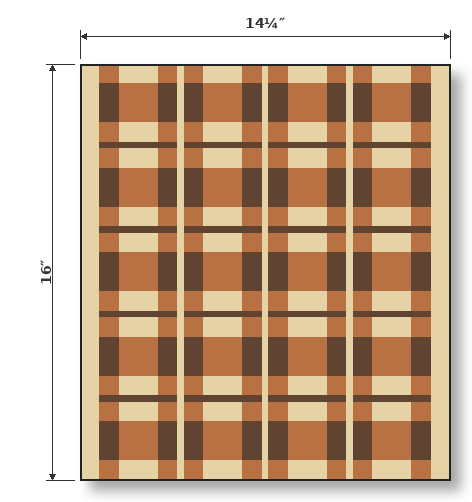

## 3. Volume Sanity Check

Review the per-species volumes against inventory.

| Species | Available | Required | Volume Offset |
| --- | --- | --- | --- |
| maple | 5.6 BF | 1.4 BF + 1.0 BF loss = 2.4 BF | +3.1 BF (229%) |
| cherry | 2.9 BF | 1.6 BF + 1.0 BF loss = 2.6 BF | +0.3 BF (111%) |
| walnut | 3.8 BF | 1.0 BF + 0.7 BF loss = 1.7 BF | +2.0 BF (218%) |

## 4. Crosscut Blanks

This plan involves cutting blanks from the inventory — review the inventory and the planned cuts.

| Raw board | Species | Raw length | Blanks (id = length) | Leftover |
| --- | --- | --- | --- | --- |
| BM1 | maple | 98¹⁄₁₆″ | BM1A = 38⅞″; BM1B = 38⅞″ | 20¹⁄₁₆″ |
| BC1 | cherry | 37″ | BC1A = 38⅞″ | -1⅞″ (overflow!) |
| BC2 | cherry | 37″ | BC2A = 38⅞″ | -1⅞″ (overflow!) |
| BW1 | walnut | 54⁵⁄₁₆″ | BW1A = 38⅞″ | 15⁵⁄₁₆″ |
| BW2 | walnut | 54⁵⁄₁₆″ | BW2A = 38⅞″ | 15⁵⁄₁₆″ |
| BM2 | maple | 47¹⁵⁄₁₆″ | — (untouched spare) | — |

### Crosscut Diagram

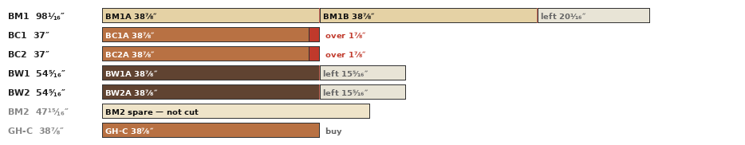

## 5. Initial board rips (the cut list)

Review the rip list.

| Board | Origin | Species | Length | Rips (width × count) | Used | Loss | Margin |
| --- | --- | --- | --- | --- | --- | --- | --- |
| BM1A @ 6″ | BM1 | maple | 38⅞″ | 1½″ ×4 · ¾″ ×1 · ¼″ ×1 | 7″ | 1⅛″ | -2⅛″ |
| BM1B @ 6″ | BM1 | maple | 38⅞″ | ¾″ ×3 | 2¼″ | ⁹⁄₁₆″ | 3³⁄₁₆″ |
| ↳ margin crosscuts | remainder of BM1B | maple | 37⅜″ | BM1B1 = 17¾″; BM1B2 = 19⅜″ | 37⅛″ | ¼″ | 1½″ |
| BM1B1 @ 3³⁄₁₆″ | remainder of BM1B | maple | 17¾″ | ¾″ ×1 · ¼″ ×2 | 1¼″ | ⁹⁄₁₆″ | 1⅜″ |
| BM1B2 @ 3³⁄₁₆″ | remainder of BM1B | maple | 19⅜″ | ¼″ ×10 | 2½″ | 1⅞″ | -1³⁄₁₆″ |
| BC1A @ 7³⁄₁₆″ | BC1 | cherry | 38⅞″ | 1½″ ×3 · ¾″ ×2 | 6″ | ¹⁵⁄₁₆″ | ¼″ |
| BC2A @ 6½″ | BC2 | cherry | 38⅞″ | 1½″ ×1 · ¾″ ×5 | 5¼″ | 1⅛″ | ⅛″ |
| GH-C @ ¹⁵⁄₁₆″ | *None* | cherry | 38⅞″ | ¾″ ×1 | ¾″ | ³⁄₁₆″ | 0″ |
| BW1A @ 6¼″ | BW1 | walnut | 38⅞″ | 3″ ×1 · ¾″ ×3 | 5¼″ | ¾″ | ¼″ |
| BW2A @ 6¹⁄₁₆″ | BW2 | walnut | 38⅞″ | ¾″ ×5 | 3¾″ | ¹⁵⁄₁₆″ | 1⅜″ |

### Board Rip Diagram

Review the board rip diagrams against the rip list.

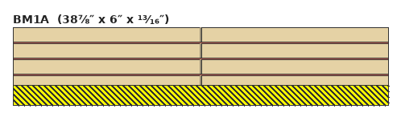
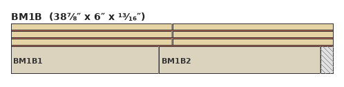
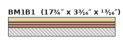
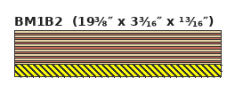
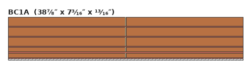
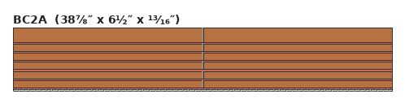

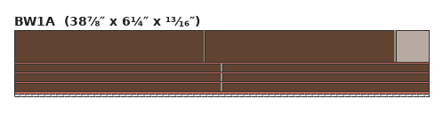
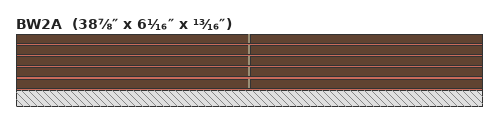

## 6. Panels overview

| Panel | Qty | Length | Slices | Height | Ripped | Sequence (outer → in) |
| --- | --- | --- | --- | --- | --- | --- |
| SL | 2 | 19⅜″ | 11 | ¾″ | — | Me · C2 · M1 · C2 · Md · C2 · M1 · C2 · Md |
| SR | 2 | 19⅜″ | 11 | ¾″ | — | Me · C2 · M1 · C2 · Md · C2 · M1 · C2 |
| ML | 2 | 19⅜″ | 11 | ¾″ | — | Me · W2 · C1 · W2 · Md · W2 · C1 · W2 · Md |
| MR | 2 | 19⅜″ | 11 | ¾″ | — | Me · W2 · C1 · W2 · Md · W2 · C1 · W2 |
| H | 1 | 17¾″ | 10 (L:5 + R:5) | ¼″ | 2× (¼″) | Me · W1 · Md · W1 · Md |

### Panel End Grain Diagram

Review the panel end-grain diagrams.

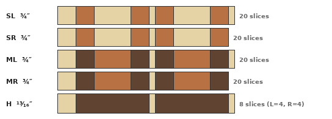

### Panel Face Diagram

Review the panel face diagrams.

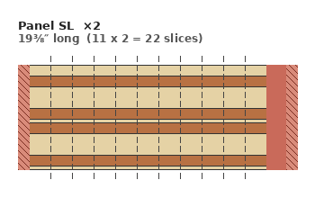
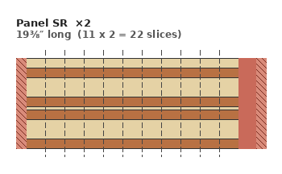
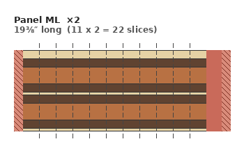
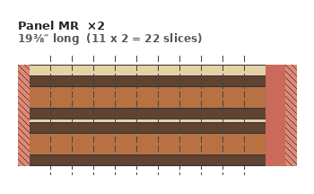
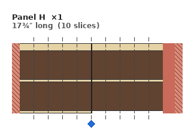

### Slice Fulfillment

Review slice demand, supply, and offset.

| Slice | Demand | Supplied | Supply Offset |
| --- | --- | --- | --- |
| SL | 10 × 2 = 20 | 22 | +2 |
| SR | 10 × 2 = 20 | 22 | +2 |
| ML | 10 × 2 = 20 | 22 | +2 |
| MR | 10 × 2 = 20 | 22 | +2 |
| H-L | 4 × 2 = 8 | 5 × 2 = 10 | +2 |
| H-R | 4 × 2 = 8 | 5 × 2 = 10 | +2 |

## 7. Components

Review component demand, fulfillment, and shortfall.

| Component | Species | Width | Length | Demand | Fulfilled | Shortfall |
| --- | --- | --- | --- | --- | --- | --- |
| C1 | cherry | 1½″ | 19⅜″ | 8 | 8 | 0 |
| C2 | cherry | ¾″ | 19⅜″ | 16 | 16 | 0 |
| M1 | maple | 1½″ | 19⅜″ | 8 | 8 | 0 |
| Md | maple | ¼″ | 19⅜″ | 12 | 12 | 0 |
| Md | maple | ¼″ | 17¾″ | 2 | 2 | 0 |
| Me | maple | ¾″ | 19⅜″ | 8 | 8 | 0 |
| Me | maple | ¾″ | 17¾″ | 1 | 1 | 0 |
| W1 | walnut | 3″ | 17¾″ | 2 | 2 | 0 |
| W2 | walnut | ¾″ | 19⅜″ | 16 | 16 | 0 |

## 8. Panels (profiles and sequence)

Review the panels and their quantities.

| Panel | Qty | Length | Profiles (slices) | Component sequence |
| --- | --- | --- | --- | --- |
| SL | 2 | 19⅜″ | single: 11 | Me · C2 · M1 · C2 · Md · C2 · M1 · C2 · Md |
| SR | 2 | 19⅜″ | single: 11 | Me · C2 · M1 · C2 · Md · C2 · M1 · C2 |
| ML | 2 | 19⅜″ | single: 11 | Me · W2 · C1 · W2 · Md · W2 · C1 · W2 · Md |
| MR | 2 | 19⅜″ | single: 11 | Me · W2 · C1 · W2 · Md · W2 · C1 · W2 |
| H | 1 | 17¾″ | L: 5, R: 5 | Me · W1 · Md · W1 · Md |
