# Plaid v1 — Cut Plan

*Two end-grain plaid cutting boards built from cherry, walnut, and brown maple.*

Cut list for the finished design, in build order.

## 1. Warnings

| # | Lvl | Type | Message |
| --- | --- | --- | --- |
| 1 | WARNING | Ghost Boards | 3 board(s) must be bought (not in inventory): GH-B, GH-C, GH-W. |
| 2 | WARNING | Small Margin | Board BM2A leaves only ⅛″ margin (< ¼″) — too tight; prone to under-supplying strips if the board runs narrow. |
| 3 | WARNING | Small Margin | Board BC1A leaves only 0″ margin (< ¼″) — too tight; prone to under-supplying strips if the board runs narrow. |
| 4 | WARNING | Small Margin | Board BC2A leaves only ¹⁄₁₆″ margin (< ¼″) — too tight; prone to under-supplying strips if the board runs narrow. |
| 5 | WARNING | Planer Gang Too Small | There aren't enough 3″ strips to gang together to safely pass through the planer without tipping over. You might need sacrificial wood to tape onto it in order to prevent movement. |

## 2. Finished board pattern

2 finished boards. Final thickness 1¼″.

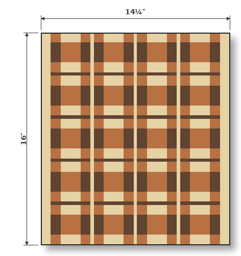

## 3. Volume Sanity Check

Review the per-species volumes against inventory.

| Species | Available | Required | Volume Offset |
| --- | --- | --- | --- |
| maple | 4.7 BF | 1.4 BF + 1.0 BF loss = 2.4 BF | +2.3 BF (196%) |
| cherry | 2.6 BF | 1.6 BF + 1.0 BF loss = 2.6 BF | +0.0 BF (101%) |
| walnut | 2.7 BF | 1.0 BF + 0.7 BF loss = 1.7 BF | +1.0 BF (156%) |

## 4. Crosscut Blanks

This plan involves cutting blanks from the inventory — review the inventory and the planned cuts.

| Raw board | Species | Raw length | Blanks (id = length) | Leftover |
| --- | --- | --- | --- | --- |
| BM1 | maple | 60″ | BM1A = 48″ | 11⅞″ |
| BM2 | maple | 60″ | BM2A = 48″ | 11⅞″ |
| BC1 | cherry | 40″ | BC1A = 40″ (used whole) | 0″ |
| BC2 | cherry | 40″ | BC2A = 40″ (used whole) | 0″ |
| BW1 | walnut | 48″ | BW1A = 48″ (used whole) | 0″ |
| BW2 | walnut | 48″ | BW2A = 48″ (used whole) | 0″ |

### Crosscut Diagram

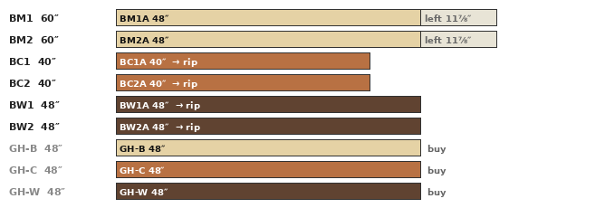

## 5. Initial board rips (the cut list)

Review the rip list.

| Board | Origin | Species | Length | Rips (width × count) | Used | Loss | Margin |
| --- | --- | --- | --- | --- | --- | --- | --- |
| BM1A @ 7″ | BM1 | maple | 48″ | 1½″ ×4 | 6″ | ¾″ | ¼″ |
| BM2A @ 7″ | BM2 | maple | 48″ | ¾″ ×5 · ¼″ ×5 | 5″ | 1⅞″ | ⅛″ |
| GH-B @ ⅞″ | *None* | maple | 48″ | ¼″ ×2 | ½″ | ⅜″ | 0″ |
| BC1A @ 6″ | BC1 | cherry | 40″ | 1½″ ×3 · ¾″ ×1 | 5¼″ | ¾″ | 0″ |
| BC2A @ 5½″ | BC2 | cherry | 40″ | 1½″ ×1 · ¾″ ×4 | 4½″ | ¹⁵⁄₁₆″ | ¹⁄₁₆″ |
| GH-C @ 2¹³⁄₁₆″ | *None* | cherry | 48″ | ¾″ ×3 | 2¼″ | ⁹⁄₁₆″ | 0″ |
| BW1A @ 5″ | BW1 | walnut | 48″ | 3″ ×1 · ¾″ ×1 | 3¾″ | ⅜″ | ⅞″ |
| BW2A @ 5″ | BW2 | walnut | 48″ | ¾″ ×5 | 3¾″ | ¹⁵⁄₁₆″ | ⁵⁄₁₆″ |
| GH-W @ 1⅞″ | *None* | walnut | 48″ | ¾″ ×2 | 1½″ | ⅜″ | 0″ |

### Board Rip Diagram

Review the board rip diagrams against the rip list.

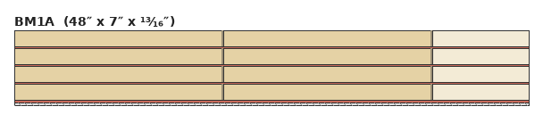
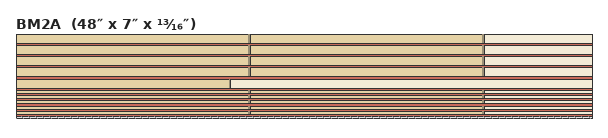

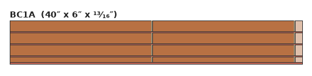
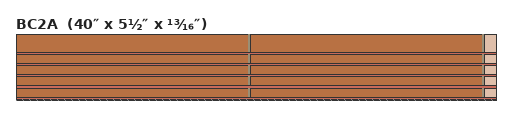

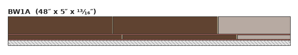
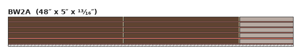

## 6. Panels overview

| Panel | Qty | Length | Slices | Height | Ripped | Sequence (outer → in) |
| --- | --- | --- | --- | --- | --- | --- |
| SL | 2 | 19⅜″ | 11 | ¾″ | — | Me · C2 · M1 · C2 · Md · C2 · M1 · C2 · Md |
| SR | 2 | 19⅜″ | 11 | ¾″ | — | Me · C2 · M1 · C2 · Md · C2 · M1 · C2 |
| ML | 2 | 19⅜″ | 11 | ¾″ | — | Me · W2 · C1 · W2 · Md · W2 · C1 · W2 · Md |
| MR | 2 | 19⅜″ | 11 | ¾″ | — | Me · W2 · C1 · W2 · Md · W2 · C1 · W2 |
| H | 1 | 17¾″ | 10 (L:5 + R:5) | ¼″ | 2× (¼″) | Me · W1 · Md · W1 · Md |

### Panel End Grain Diagram

Review the panel end-grain diagrams.

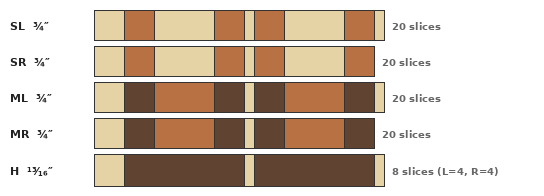

### Panel Face Diagram

Review the panel face diagrams.

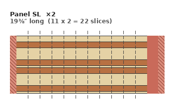
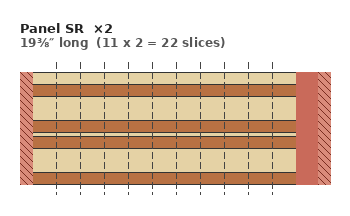
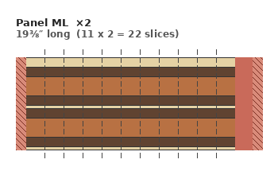
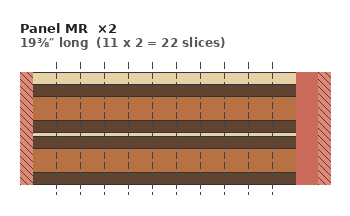
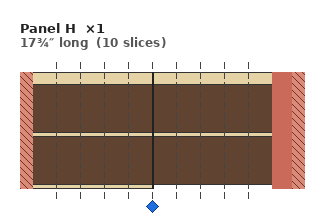

### Slice Fulfillment

Review slice demand, supply, and offset.

| Slice | Demand | Supplied | Supply Offset |
| --- | --- | --- | --- |
| SL | 10 × 2 = 20 | 22 | +2 |
| SR | 10 × 2 = 20 | 22 | +2 |
| ML | 10 × 2 = 20 | 22 | +2 |
| MR | 10 × 2 = 20 | 22 | +2 |
| H-L | 4 × 2 = 8 | 5 × 2 = 10 | +2 |
| H-R | 4 × 2 = 8 | 5 × 2 = 10 | +2 |

## 7. Components

Review component demand, fulfillment, and shortfall.

| Component | Species | Width | Length | Demand | Fulfilled | Shortfall |
| --- | --- | --- | --- | --- | --- | --- |
| C1 | cherry | 1½″ | 19⅜″ | 8 | 8 | 0 |
| C2 | cherry | ¾″ | 19⅜″ | 16 | 16 | 0 |
| M1 | maple | 1½″ | 19⅜″ | 8 | 8 | 0 |
| Md | maple | ¼″ | 19⅜″ | 12 | 12 | 0 |
| Md | maple | ¼″ | 17¾″ | 2 | 2 | 0 |
| Me | maple | ¾″ | 19⅜″ | 8 | 8 | 0 |
| Me | maple | ¾″ | 17¾″ | 1 | 1 | 0 |
| W1 | walnut | 3″ | 17¾″ | 2 | 2 | 0 |
| W2 | walnut | ¾″ | 19⅜″ | 16 | 16 | 0 |

## 8. Panels (profiles and sequence)

Review the panels and their quantities.

| Panel | Qty | Length | Profiles (slices) | Component sequence |
| --- | --- | --- | --- | --- |
| SL | 2 | 19⅜″ | single: 11 | Me · C2 · M1 · C2 · Md · C2 · M1 · C2 · Md |
| SR | 2 | 19⅜″ | single: 11 | Me · C2 · M1 · C2 · Md · C2 · M1 · C2 |
| ML | 2 | 19⅜″ | single: 11 | Me · W2 · C1 · W2 · Md · W2 · C1 · W2 · Md |
| MR | 2 | 19⅜″ | single: 11 | Me · W2 · C1 · W2 · Md · W2 · C1 · W2 |
| H | 1 | 17¾″ | L: 5, R: 5 | Me · W1 · Md · W1 · Md |
