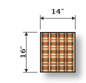
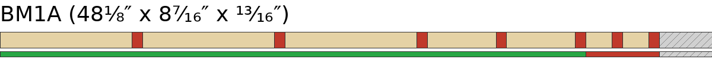
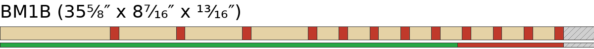
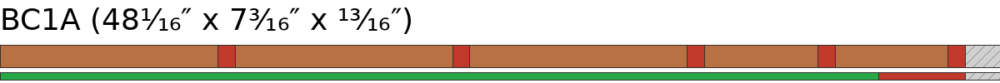
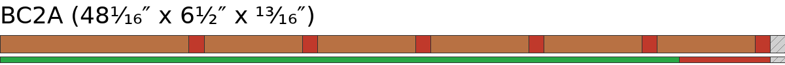
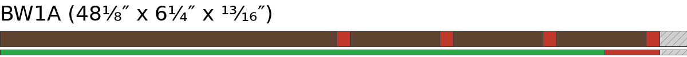
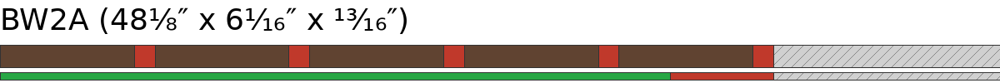
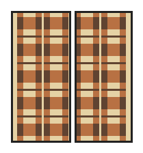

# Plaid v2 — Plan Checklist (hand, actual)

## Phase 1 — Initial crosscuts

| [ ] | Raw board | Species | Blank | Length | Off Cut |
| --- | --- | --- | --- | --- | --- |
| [ ] | BM1 (98¹⁄₁₆″) | Brown Maple | BM1A | 48⅛″ | 49¹³⁄₁₆″ |
| [ ] | BM1 ↩ | Brown Maple | BM1B | 35⅝″ | 14¹⁄₁₆″ |
| [ ] | BW1 (54⁵⁄₁₆″) | Walnut | BW1A | 48⅛″ | 6¹⁄₁₆″ |
| [ ] | BW2 (54⁵⁄₁₆″) | Walnut | BW2A | 48⅛″ | 6¹⁄₁₆″ |

Boards to be stripped in their entirety, no Phase 1 crosscut: BC1 (Cherry, 48¹⁄₁₆″), BC2 (Cherry, 48¹⁄₁₆″).
Spare — do not cut: BM2 (Brown Maple, 47¹⁵⁄₁₆″).

## Phase 2 — Rips

### Phase 2.1 — BM1A — Brown Maple

| [ ] | Rip | Rip size | Final width | Length | Pieces planned |
| --- | --- | --- | --- | --- | --- |
| [ ] | 1 | 1⁹⁄₁₆″ (1.56″) | 1½″ (1.50″) | 48⅛″ | 15⅞″x3 |
| [ ] | 2 | 1⁹⁄₁₆″ (1.56″) | 1½″ (1.50″) | 48⅛″ | 15⅞″x3 |
| [ ] | 3 | 1⁹⁄₁₆″ (1.56″) | 1½″ (1.50″) | 48⅛″ | 15⅞″x3 |
| [ ] | 4 | ¹³⁄₁₆″ (0.81″) | ¾″ (0.75″) | 48⅛″ | 15⅞″x3 |
| [ ] | 5 | ¹³⁄₁₆″ (0.81″) | ¾″ (0.75″) | 48⅛″ | 15⅞″x3 |
| [ ] | 6 | ⁵⁄₁₆″ (0.31″) | ¼″ (0.25″) | 48⅛″ | 15⅞″x3 |
| [ ] | 7 | ⁵⁄₁₆″ (0.31″) | ¼″ (0.25″) | 48⅛″ | 15⅞″x3 |

Board width 8⁷⁄₁₆″ = used 6½″ + loss 1⁵⁄₁₆″ + margin ⅝″.

### Phase 2.2 — BM1B — Brown Maple

| [ ] | Rip | Rip size | Final width | Length | Pieces planned |
| --- | --- | --- | --- | --- | --- |
| [ ] | 1 | 1⁹⁄₁₆″ (1.56″) | 1½″ (1.50″) | 35⅝″ | 15⅞″x2 |
| [ ] | 2 | ¹³⁄₁₆″ (0.81″) | ¾″ (0.75″) | 35⅝″ | 15⅞″, 17¾″ |
| [ ] | 3 | ¹³⁄₁₆″ (0.81″) | ¾″ (0.75″) | 35⅝″ | 15⅞″x2 |
| [ ] | 4 | ¹³⁄₁₆″ (0.81″) | ¾″ (0.75″) | 35⅝″ | 15⅞″x2 |
| [ ] | 5 | ⁵⁄₁₆″ (0.31″) | ¼″ (0.25″) | 35⅝″ | 15⅞″, 17¾″ |
| [ ] | 6 | ⁵⁄₁₆″ (0.31″) | ¼″ (0.25″) | 35⅝″ | 15⅞″, 17¾″ |
| [ ] | 7 | ⁵⁄₁₆″ (0.31″) | ¼″ (0.25″) | 35⅝″ | 15⅞″x2 |
| [ ] | 8 | ⁵⁄₁₆″ (0.31″) | ¼″ (0.25″) | 35⅝″ | 15⅞″x2 |
| [ ] | 9 | ⁵⁄₁₆″ (0.31″) | ¼″ (0.25″) | 35⅝″ | 15⅞″x2 |
| [ ] | 10 | ⁵⁄₁₆″ (0.31″) | ¼″ (0.25″) | 35⅝″ | 15⅞″x2 |
| [ ] | 11 | ⁵⁄₁₆″ (0.31″) | ¼″ (0.25″) | 35⅝″ | 15⅞″x2 |
| [ ] | 12 | ⁵⁄₁₆″ (0.31″) | ¼″ (0.25″) | 35⅝″ | 15⅞″x2 |

Board width 8⁷⁄₁₆″ = used 5¾″ + loss 2¼″ + margin ⁷⁄₁₆″.

### Phase 2.3 — BC1A — Cherry

| [ ] | Rip | Rip size | Final width | Length | Pieces planned |
| --- | --- | --- | --- | --- | --- |
| [ ] | 1 | 1⁹⁄₁₆″ (1.56″) | 1½″ (1.50″) | 48¹⁄₁₆″ | 15⅞″x3 |
| [ ] | 2 | 1⁹⁄₁₆″ (1.56″) | 1½″ (1.50″) | 48¹⁄₁₆″ | 15⅞″x3 |
| [ ] | 3 | 1⁹⁄₁₆″ (1.56″) | 1½″ (1.50″) | 48¹⁄₁₆″ | 15⅞″x3 |
| [ ] | 4 | ¹³⁄₁₆″ (0.81″) | ¾″ (0.75″) | 48¹⁄₁₆″ | 15⅞″x3 |
| [ ] | 5 | ¹³⁄₁₆″ (0.81″) | ¾″ (0.75″) | 48¹⁄₁₆″ | 15⅞″x3 |

Board width 7³⁄₁₆″ = used 6″ + loss ¹⁵⁄₁₆″ + margin ¼″.

### Phase 2.4 — BC2A — Cherry

| [ ] | Rip | Rip size | Final width | Length | Pieces planned |
| --- | --- | --- | --- | --- | --- |
| [ ] | 1 | 1⁹⁄₁₆″ (1.56″) | 1½″ (1.50″) | 48¹⁄₁₆″ | 15⅞″x3 |
| [ ] | 2 | ¹³⁄₁₆″ (0.81″) | ¾″ (0.75″) | 48¹⁄₁₆″ | 15⅞″x3 |
| [ ] | 3 | ¹³⁄₁₆″ (0.81″) | ¾″ (0.75″) | 48¹⁄₁₆″ | 15⅞″x3 |
| [ ] | 4 | ¹³⁄₁₆″ (0.81″) | ¾″ (0.75″) | 48¹⁄₁₆″ | 15⅞″x3 |
| [ ] | 5 | ¹³⁄₁₆″ (0.81″) | ¾″ (0.75″) | 48¹⁄₁₆″ | 15⅞″x3 |
| [ ] | 6 | ¹³⁄₁₆″ (0.81″) | ¾″ (0.75″) | 48¹⁄₁₆″ | 15⅞″x2 |

Board width 6½″ = used 5¼″ + loss 1⅛″ + margin ⅛″.

### Phase 2.5 — BW1A — Walnut

| [ ] | Rip | Rip size | Final width | Length | Pieces planned |
| --- | --- | --- | --- | --- | --- |
| [ ] | 1 | 3¹⁄₁₆″ (3.06″) | 3″ (3.00″)* | 48⅛″ | 17¾″x2 |
| [ ] | 2 | ¹³⁄₁₆″ (0.81″) | ¾″ (0.75″) | 48⅛″ | 15⅞″x3 |
| [ ] | 3 | ¹³⁄₁₆″ (0.81″) | ¾″ (0.75″) | 48⅛″ | 15⅞″x3 |
| [ ] | 4 | ¹³⁄₁₆″ (0.81″) | ¾″ (0.75″) | 48⅛″ | 15⅞″x3 |

Board width 6¼″ = used 5¼″ + loss ¾″ + margin ¼″.

### Phase 2.6 — BW2A — Walnut

| [ ] | Rip | Rip size | Final width | Length | Pieces planned |
| --- | --- | --- | --- | --- | --- |
| [ ] | 1 | ¹³⁄₁₆″ (0.81″) | ¾″ (0.75″) | 48⅛″ | 15⅞″x3 |
| [ ] | 2 | ¹³⁄₁₆″ (0.81″) | ¾″ (0.75″) | 48⅛″ | 15⅞″x3 |
| [ ] | 3 | ¹³⁄₁₆″ (0.81″) | ¾″ (0.75″) | 48⅛″ | 15⅞″x3 |
| [ ] | 4 | ¹³⁄₁₆″ (0.81″) | ¾″ (0.75″) | 48⅛″ | 15⅞″x3 |
| [ ] | 5 | ¹³⁄₁₆″ (0.81″) | ¾″ (0.75″) | 48⅛″ | 15⅞″x3 |

Board width 6¹⁄₁₆″ = used 3¾″ + loss ¹⁵⁄₁₆″ + margin 1⅜″.

## Phase 3 — Plane by width

### Phase 3.1 — Gang — Plane to 3″ — planer setting 3″ (2 components) — requires a gang

**ERROR — Gang insufficient: 3″ width needs 4 pieces at ¹³⁄₁₆″ to reach 3″, but only 1 strip(s) total ¹³⁄₁₆″ and 2 component(s) total 1⅝″. Do not plane singly.**

Crosscut first:

| Cuts | Board | Strip | Species | Pieces | Off Cut |
| --- | --- | --- | --- | --- | --- |
| [ ] [ ] | BW1A | 1 | Walnut | 17¾″x2 | 12⅜″ |

Plane as gang:

| [ ] | Species | Count |
| --- | --- | --- |
| [ ] | Walnut | 2 components |

### Phase 3.2 — Gang — Plane to 1½″ — planer setting 1½″ (8 strips) — requires a gang

Requires a gang — tape strips together; total thickness 6½″ ≥ 1½″.

| [ ] | Species | Count |
| --- | --- | --- |
| [ ] | Brown Maple | 4 strips |
| [ ] | Cherry | 4 strips |

### Phase 3.3 — Gang — Plane to ¾″ — planer setting ¾″ (20 strips)

| [ ] | Species | Count |
| --- | --- | --- |
| [ ] | Brown Maple | 5 strips |
| [ ] | Cherry | 7 strips |
| [ ] | Walnut | 8 strips |

### Phase 3.4 — Gang — Plane to ¼″ — planer setting ¼″ (10 strips)

| [ ] | Species | Count |
| --- | --- | --- |
| [ ] | Brown Maple | 10 strips |

## Phase 4 — Crosscut components

### Phase 4.1 — Crosscut grouping — by length

| Length | Species | Final width | Pieces |
| --- | --- | --- | --- |
| 15⅞″ | Brown Maple | 1½″ (1.50″) | 11 |
| 15⅞″ | Brown Maple | ¾″ (0.75″) | 11 |
| 15⅞″ | Brown Maple | ¼″ (0.25″) | 20 |
| 15⅞″ | Cherry | 1½″ (1.50″) | 12 |
| 15⅞″ | Cherry | ¾″ (0.75″) | 20 |
| 15⅞″ | Walnut | ¾″ (0.75″) | 24 |
| 17¾″ | Brown Maple | ¾″ (0.75″) | 1 |
| 17¾″ | Brown Maple | ¼″ (0.25″) | 2 |

Totals: 15⅞″ ×98, 17¾″ ×3.

### Phase 4.2 — BM1A — Brown Maple

| Cuts | Strip | Species | Final width | Pieces | Off Cut |
| --- | --- | --- | --- | --- | --- |
| [ ] [ ] [ ] | 1 | Brown Maple | 1½″ (1.50″) | 15⅞″x3 | ⅛″ |
| [ ] [ ] [ ] | 2 | Brown Maple | 1½″ (1.50″) | 15⅞″x3 | ⅛″ |
| [ ] [ ] [ ] | 3 | Brown Maple | 1½″ (1.50″) | 15⅞″x3 | ⅛″ |
| [ ] [ ] [ ] | 4 | Brown Maple | ¾″ (0.75″) | 15⅞″x3 | ⅛″ |
| [ ] [ ] [ ] | 5 | Brown Maple | ¾″ (0.75″) | 15⅞″x3 | ⅛″ |
| [ ] [ ] [ ] | 6 | Brown Maple | ¼″ (0.25″) | 15⅞″x3 | ⅛″ |
| [ ] [ ] [ ] | 7 | Brown Maple | ¼″ (0.25″) | 15⅞″x3 | ⅛″ |

### Phase 4.3 — BM1B — Brown Maple

| Cuts | Strip | Species | Final width | Pieces | Off Cut |
| --- | --- | --- | --- | --- | --- |
| [ ] [ ] | 1 | Brown Maple | 1½″ (1.50″) | 15⅞″x2 | 3⅝″ |
| [ ] [ ] | 2 | Brown Maple | ¾″ (0.75″) | 15⅞″, 17¾″ | 1¾″ |
| [ ] [ ] | 3 | Brown Maple | ¾″ (0.75″) | 15⅞″x2 | 3⅝″ |
| [ ] [ ] | 4 | Brown Maple | ¾″ (0.75″) | 15⅞″x2 | 3⅝″ |
| [ ] [ ] | 5 | Brown Maple | ¼″ (0.25″) | 15⅞″, 17¾″ | 1¾″ |
| [ ] [ ] | 6 | Brown Maple | ¼″ (0.25″) | 15⅞″, 17¾″ | 1¾″ |
| [ ] [ ] | 7 | Brown Maple | ¼″ (0.25″) | 15⅞″x2 | 3⅝″ |
| [ ] [ ] | 8 | Brown Maple | ¼″ (0.25″) | 15⅞″x2 | 3⅝″ |
| [ ] [ ] | 9 | Brown Maple | ¼″ (0.25″) | 15⅞″x2 | 3⅝″ |
| [ ] [ ] | 10 | Brown Maple | ¼″ (0.25″) | 15⅞″x2 | 3⅝″ |
| [ ] [ ] | 11 | Brown Maple | ¼″ (0.25″) | 15⅞″x2 | 3⅝″ |
| [ ] [ ] | 12 | Brown Maple | ¼″ (0.25″) | 15⅞″x2 | 3⅝″ |

### Phase 4.4 — BC1A — Cherry

| Cuts | Strip | Species | Final width | Pieces | Off Cut |
| --- | --- | --- | --- | --- | --- |
| [ ] [ ] [ ] | 1 | Cherry | 1½″ (1.50″) | 15⅞″x3 | ¹⁄₁₆″ |
| [ ] [ ] [ ] | 2 | Cherry | 1½″ (1.50″) | 15⅞″x3 | ¹⁄₁₆″ |
| [ ] [ ] [ ] | 3 | Cherry | 1½″ (1.50″) | 15⅞″x3 | ¹⁄₁₆″ |
| [ ] [ ] [ ] | 4 | Cherry | ¾″ (0.75″) | 15⅞″x3 | ¹⁄₁₆″ |
| [ ] [ ] [ ] | 5 | Cherry | ¾″ (0.75″) | 15⅞″x3 | ¹⁄₁₆″ |

### Phase 4.5 — BC2A — Cherry

| Cuts | Strip | Species | Final width | Pieces | Off Cut |
| --- | --- | --- | --- | --- | --- |
| [ ] [ ] [ ] | 1 | Cherry | 1½″ (1.50″) | 15⅞″x3 | ¹⁄₁₆″ |
| [ ] [ ] [ ] | 2 | Cherry | ¾″ (0.75″) | 15⅞″x3 | ¹⁄₁₆″ |
| [ ] [ ] [ ] | 3 | Cherry | ¾″ (0.75″) | 15⅞″x3 | ¹⁄₁₆″ |
| [ ] [ ] [ ] | 4 | Cherry | ¾″ (0.75″) | 15⅞″x3 | ¹⁄₁₆″ |
| [ ] [ ] [ ] | 5 | Cherry | ¾″ (0.75″) | 15⅞″x3 | ¹⁄₁₆″ |
| [ ] [ ] | 6 | Cherry | ¾″ (0.75″) | 15⅞″x2 | 16¹⁄₁₆″ |

### Phase 4.6 — BW1A — Walnut

| Cuts | Strip | Species | Final width | Pieces | Off Cut |
| --- | --- | --- | --- | --- | --- |
| [ ] [ ] [ ] | 2 | Walnut | ¾″ (0.75″) | 15⅞″x3 | ⅛″ |
| [ ] [ ] [ ] | 3 | Walnut | ¾″ (0.75″) | 15⅞″x3 | ⅛″ |
| [ ] [ ] [ ] | 4 | Walnut | ¾″ (0.75″) | 15⅞″x3 | ⅛″ |

Strip 1 (3″) already crosscut in Phase 3 gang, not repeated here.

### Phase 4.7 — BW2A — Walnut

| Cuts | Strip | Species | Final width | Pieces | Off Cut |
| --- | --- | --- | --- | --- | --- |
| [ ] [ ] [ ] | 1 | Walnut | ¾″ (0.75″) | 15⅞″x3 | ⅛″ |
| [ ] [ ] [ ] | 2 | Walnut | ¾″ (0.75″) | 15⅞″x3 | ⅛″ |
| [ ] [ ] [ ] | 3 | Walnut | ¾″ (0.75″) | 15⅞″x3 | ⅛″ |
| [ ] [ ] [ ] | 4 | Walnut | ¾″ (0.75″) | 15⅞″x3 | ⅛″ |
| [ ] [ ] [ ] | 5 | Walnut | ¾″ (0.75″) | 15⅞″x3 | ⅛″ |

Total: 39 strips, 103 component pieces. (2 pieces crosscut in Phase 3 gang, not repeated in Phase 4.)

## Phase 5 — Panel glue-ups

### Phase 5.1 — Panel S x5

15⅞″ x 7¼″ x ¾″ - 9 components - x5 duplicates

| Panels | Order | Species | Width | Component |
| --- | --- | --- | --- | --- |
| [ ] [ ] [ ] [ ] [ ] | 1 | Brown Maple | ¾″ (0.75″) | Me |
| [ ] [ ] [ ] [ ] [ ] | 2 | Cherry | ¾″ (0.75″) | C2 |
| [ ] [ ] [ ] [ ] [ ] | 3 | Brown Maple | 1½″ (1.50″) | M1 |
| [ ] [ ] [ ] [ ] [ ] | 4 | Cherry | ¾″ (0.75″) | C2 |
| [ ] [ ] [ ] [ ] [ ] | 5 | Brown Maple | ¼″ (0.25″) | Md |
| [ ] [ ] [ ] [ ] [ ] | 6 | Cherry | ¾″ (0.75″) | C2 |
| [ ] [ ] [ ] [ ] [ ] | 7 | Brown Maple | 1½″ (1.50″) | M1 |
| [ ] [ ] [ ] [ ] [ ] | 8 | Cherry | ¾″ (0.75″) | C2 |
| [ ] [ ] [ ] [ ] [ ] | 9 | Brown Maple | ¼″ (0.25″) | Md |

### Phase 5.2 — Panel ML x3

15⅞″ x 7¼″ x ¾″ - 9 components - x3 duplicates

| Panels | Order | Species | Width | Component |
| --- | --- | --- | --- | --- |
| [ ] [ ] [ ] | 1 | Brown Maple | ¾″ (0.75″) | Me |
| [ ] [ ] [ ] | 2 | Walnut | ¾″ (0.75″) | W2 |
| [ ] [ ] [ ] | 3 | Cherry | 1½″ (1.50″) | C1 |
| [ ] [ ] [ ] | 4 | Walnut | ¾″ (0.75″) | W2 |
| [ ] [ ] [ ] | 5 | Brown Maple | ¼″ (0.25″) | Md |
| [ ] [ ] [ ] | 6 | Walnut | ¾″ (0.75″) | W2 |
| [ ] [ ] [ ] | 7 | Cherry | 1½″ (1.50″) | C1 |
| [ ] [ ] [ ] | 8 | Walnut | ¾″ (0.75″) | W2 |
| [ ] [ ] [ ] | 9 | Brown Maple | ¼″ (0.25″) | Md |

### Phase 5.3 — Panel MR x3

15⅞″ x 7″ x ¾″ - 8 components - x3 duplicates

| Panels | Order | Species | Width | Component |
| --- | --- | --- | --- | --- |
| [ ] [ ] [ ] | 1 | Brown Maple | ¾″ (0.75″) | Me |
| [ ] [ ] [ ] | 2 | Walnut | ¾″ (0.75″) | W2 |
| [ ] [ ] [ ] | 3 | Cherry | 1½″ (1.50″) | C1 |
| [ ] [ ] [ ] | 4 | Walnut | ¾″ (0.75″) | W2 |
| [ ] [ ] [ ] | 5 | Brown Maple | ¼″ (0.25″) | Md |
| [ ] [ ] [ ] | 6 | Walnut | ¾″ (0.75″) | W2 |
| [ ] [ ] [ ] | 7 | Cherry | 1½″ (1.50″) | C1 |
| [ ] [ ] [ ] | 8 | Walnut | ¾″ (0.75″) | W2 |

### Phase 5.4 — Panel H

17¾″ x 7¼″ x ¼″ - 5 components - x1 duplicates

| Panels | Order | Species | Width | Component |
| --- | --- | --- | --- | --- |
| [ ] | 1 | Brown Maple | ¾″ (0.75″) | Me |
| [ ] | 2 | Walnut | 3″ (3.00″) | W1 |
| [ ] | 3 | Brown Maple | ¼″ (0.25″) | Md |
| [ ] | 4 | Walnut | 3″ (3.00″) | W1 |
| [ ] | 5 | Brown Maple | ¼″ (0.25″) | Md |

## Phase 6 — Slices

1¾″ thick (1½″ after flattening)

| [ ] | Slice | From panel | Slice Count |
| --- | --- | --- | --- |
| [ ] | S-L | S | 4 x 5 = 20 |
| [ ] | S-R | S | 4 x 5 = 20 |
| [ ] | ML | ML | 8 x 3 = 24 |
| [ ] | MR | MR | 8 x 3 = 24 |
| [ ] | H-L | H | 5 x 2 = 10 |
| [ ] | H-R | H | 5 x 2 = 10 |

## Phase 7 — Slice rips

| [ ] | Slice | Rip to | Count |
| --- | --- | --- | --- | --- |
| [ ] | H-L | ¼″ | 10 |
| [ ] | H-R | ¼″ | 10 |

## Phase 8 — Column Glue Ups

| Board | Column | Slices |
| --- | --- | --- |
| [ ] [ ] | Column 1 | 01 [ ] S-L 02 [ ] ML 03 [ ] ML 04 [ ] S-L 05 [ ] H-L 06 [ ] S-L 07 [ ] ML 08 [ ] ML 09 [ ] S-L 10 [ ] H-L 11 [ ] S-L 12 [ ] ML 13 [ ] ML 14 [ ] S-L 15 [ ] H-L 16 [ ] S-L 17 [ ] ML 18 [ ] ML 19 [ ] S-L 20 [ ] H-L 21 [ ] S-L 22 [ ] ML 23 [ ] ML 24 [ ] S-L |
| [ ] [ ] | Column 2 | 01 [ ] S-R* 02 [ ] MR* 03 [ ] MR* 04 [ ] S-R* 05 [ ] H-R* 06 [ ] S-R* 07 [ ] MR* 08 [ ] MR* 09 [ ] S-R* 10 [ ] H-R* 11 [ ] S-R* 12 [ ] MR* 13 [ ] MR* 14 [ ] S-R* 15 [ ] H-R* 16 [ ] S-R* 17 [ ] MR* 18 [ ] MR* 19 [ ] S-R* 20 [ ] H-R* 21 [ ] S-R* 22 [ ] MR* 23 [ ] MR* 24 [ ] S-R* |

## Phase 9 — Final Glue Up

| Board | Columns | Size |
| --- | --- | --- |
| [ ] | Column 1 + Column 2 | 14¼″ × 16″ × 1½″ |
| [ ] | Column 1 + Column 2 | 14¼″ × 16″ × 1½″ |

## Phase 10 — Finishing

Final dimensions: 14″ × 16″ × 1¼″

| Board | Width trim | Length trim | Flatten | Sanding (grits) | Oil | Wax |
| --- | --- | --- | --- | --- | --- | --- |
| [ ] | 14¼″ → 14″ | 16″ → 16″ | 1½″ → 1¼″ | [ ] 80 [ ] 120 [ ] 220 [ ] 320 | [ ] | [ ] |
| [ ] | 14¼″ → 14″ | 16″ → 16″ | 1½″ → 1¼″ | [ ] 80 [ ] 120 [ ] 220 [ ] 320 | [ ] | [ ] |
