# Plaid v2 — Cut Plan

*Two end-grain plaid cutting boards built from cherry, walnut, and brown maple.*

This is a generated plan: the finished design and the cut list that realizes it on the boards in hand. Where the cut list cannot be met from inventory it calls for **bought boards** — buy those and re-run before cutting. The sections follow the build order, from the first crosscut to the final slice-grid assembly.

## 1. Warnings

| # | Lvl | Type | Message |
| --- | --- | --- | --- |
| 1 | ERROR | Planer Gang Too Small | Strip width 3″ is wider than board thickness ¹³⁄₁₆″, and its gang is too small even after crosscutting to component lengths first: 1 strip(s) total ¹³⁄₁₆″, 2 component(s) total 1⅝″, both below 3″ (needs 4 pieces at ¹³⁄₁₆″). Do not plane singly. |
| 2 | WARNING | Small Margin | Board BC2A leaves only ⅛″ margin (< ¼″) — too tight; prone to under-supplying strips if the board runs narrow. |
| 3 | WARNING | Zero Offcut | 30 strip(s) crosscut to an exact fit with 0″ offcut — no margin for cutting error in the crosscut phase: BM1A ×5, BM1B ×7, BC1A ×5, BC2A ×5, BW1A ×3, BW2A ×5. A cut even slightly long, or kerf drift, will make the last piece short. Consider longer blanks or fewer pieces per strip. |
| 4 | NOTE | No Spare Slices | No spare slices for: S-L, S-R (supply exactly meets demand). Consider slightly larger/more panels so a bad slice does not cause a shortfall. |

## 2. Finished board pattern

2 finished boards. Final size 14″ × 16″ × 1¼″.

## 3. Volume Sanity Check

A per-species feasibility check in board feet (1 BF = 144 cubic inches). **Required** is the surfaced volume of every installed slice across all 2 board(s) plus the volume that must be removed to produce them — flattening (sliceDepth − finishedThickness), planing all four edges (minPlaneLoss), and one miter kerf per slice. **Available** is the inventory stock volume. **Volume Offset** = available − required, with available as a percentage of required in parentheses (100% means they are equal); a negative value means the project cannot be built from stock in hand.

| Species | Available | Required | Volume Offset |
| --- | --- | --- | --- |
| maple | 6.9 BF | 1.4 BF + 1.0 BF loss = 2.5 BF | +4.4 BF (277%) |
| cherry | 3.7 BF | 1.6 BF + 1.0 BF loss = 2.6 BF | +1.1 BF (144%) |
| walnut | 3.8 BF | 1.0 BF + 0.7 BF loss = 1.7 BF | +2.0 BF (218%) |

## 4. Crosscut Blanks

The first operation: crosscut each raw inventory board along its length into the labeled board blanks that get ripped later (the Initial board rips section, which follows immediately, ahead of Panels overview). Boards that start from another board's leftover margin are not raw-stock crosscuts — they appear as the labeled offcuts in the Board Rip Diagram and as a crosscut row (↳) after their parent board's row in the rip cut table.

| Raw board | Species | Raw length | Blanks (id = length) | Leftover |
| --- | --- | --- | --- | --- |
| BM1 | maple | 98¹⁄₁₆″ | BM1A = 47⅞″; BM1B = 47⅞″ | 2¹⁄₁₆″ |
| BC1 | cherry | 48¹⁄₁₆″ | BC1A = 47⅞″ | ¹⁄₁₆″ |
| BC2 | cherry | 48¹⁄₁₆″ | BC2A = 47⅞″ | ¹⁄₁₆″ |
| BW1 | walnut | 54⁵⁄₁₆″ | BW1A = 47⅞″ | 6⁵⁄₁₆″ |
| BW2 | walnut | 54⁵⁄₁₆″ | BW2A = 47⅞″ | 6⁵⁄₁₆″ |
| BM2 | maple | 47¹⁵⁄₁₆″ | — (untouched spare) | — |

### Crosscut Diagram

Each bar is one raw board drawn to scale by length; segments are the blanks (labeled with id and length inside), reddish stripes are crosscut kerfs (sawdust), and the pale tail is leftover length. A red tail means the blanks overflow the raw board. An untouched spare is shown washed-out and uncut; a board used whole goes straight to the rip diagram. The bars below are the individual primitives, left-aligned (not floated side by side); the combined diagram is also saved in images/ as crosscut-blanks-*.png.

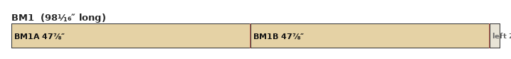
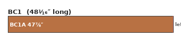
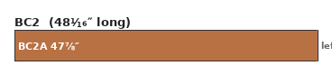
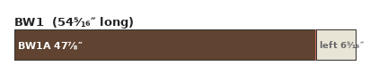

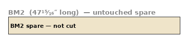

## 5. Initial board rips (the cut list)

Each row is one physical board at the saw: rip the strips down its width, then crosscut each strip to the piece lengths. The **Board** column shows `id @ width` — the board's width when ripping begins. **Used** is the summed strip width, **Loss** is rip kerf + planer cleanup per strip, **Margin** is the leftover width (negative = the strips do not fit; large = the board is oversized for what it yields).

A board whose leftover margin is itself the source of other boards gets a crosscut row (↳) immediately after its own row: it lists, in cut-spec document order, the child boards crosscut off that margin slab, the miter kerf between them, and the slab tail left after the last crosscut. For a crosscut row the Used / Loss / Margin figures are length-axis, not width-axis: Used is the total child length, Loss is the miter kerf consumed, Margin is the slab tail.

| Board | Origin | Species | Length | Rips (width × count) | Used | Loss | Margin |
| --- | --- | --- | --- | --- | --- | --- | --- |
| BM1A @ 8⁷⁄₁₆″ | BM1 | maple | 47⅞″ | 1½″ ×4 · ¾″ ×1 · ¼″ ×1 | 7″ | 1⅛″ | ⁵⁄₁₆″ |
| BM1B @ 8⁷⁄₁₆″ | BM1 | maple | 47⅞″ | ¾″ ×4 · ¼″ ×7 | 4¾″ | 2¹⁄₁₆″ | 1⅝″ |
| BC1A @ 7³⁄₁₆″ | BC1 | cherry | 47⅞″ | 1½″ ×3 · ¾″ ×2 | 6″ | ¹⁵⁄₁₆″ | ¼″ |
| BC2A @ 6½″ | BC2 | cherry | 47⅞″ | 1½″ ×1 · ¾″ ×5 | 5¼″ | 1⅛″ | ⅛″ |
| BW1A @ 6¼″ | BW1 | walnut | 47⅞″ | 3″ ×1 · ¾″ ×3 | 5¼″ | ¾″ | ¼″ |
| BW2A @ 6¹⁄₁₆″ | BW2 | walnut | 47⅞″ | ¾″ ×5 | 3¾″ | ¹⁵⁄₁₆″ | 1⅜″ |

### Board Rip Diagram

Each labeled block below is one physical board. Horizontal bands are the strips ripped down the board's width; within a band, the colored cells are the crosscut pieces (with thin kerf gaps between them) and the lightened tail is the offcut. The pale band under the strips is the leftover margin; a gray title marks a board that must be bought. The blocks below are the individual primitives, flowed to fill the page width instead of one tall combined diagram; the combined diagram is also saved as strip-map.png at the plan root and as images/strip-map-*.png, for a single-image copy of the cut diagram.

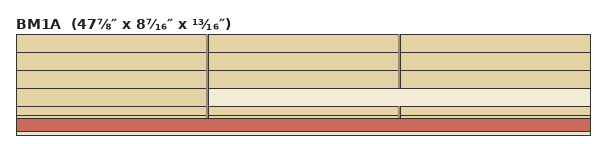
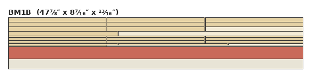
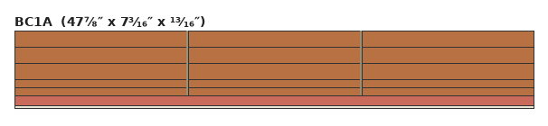
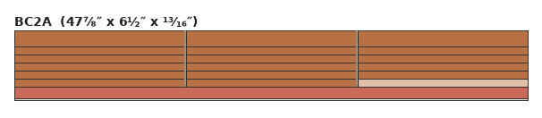
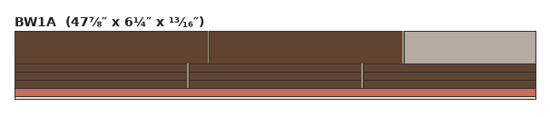
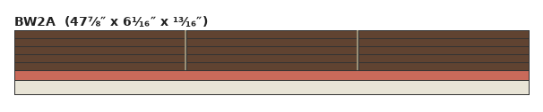

## 6. Panels overview

| Panel | Qty | Length | Slices | Height | Ripped | Sequence (outer → in) |
| --- | --- | --- | --- | --- | --- | --- |
| S | 5 | 15⅞″ | 8 (L:4 + R:4) | ¾″ | — | Me · C2 · M1 · C2 · Md · C2 · M1 · C2 · Md |
| ML | 3 | 15⅞″ | 8 | ¾″ | — | Me · W2 · C1 · W2 · Md · W2 · C1 · W2 · Md |
| MR | 3 | 15⅞″ | 8 | ¾″ | — | Me · W2 · C1 · W2 · Md · W2 · C1 · W2 |
| H | 1 | 17¾″ | 10 (L:5 + R:5) | ¼″ | 2× (¼″) | Me · W1 · Md · W1 · Md |

### Panel End Grain Diagram

Each panel's end-grain cross-section (the glue-up of component stripes). The panels below are the individual primitives, centered in the PDF; the combined diagram is also saved in images/ as panels-*.png.

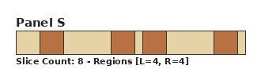
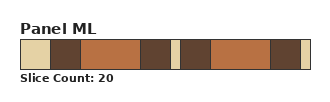
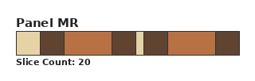
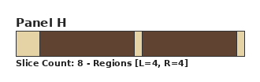

### Panel Face Diagram

Each panel drawn to scale with its length running left-to-right, wider than tall, centered in the PDF at 75% of its rendered size, with the panel body moved down away from its title. Components are horizontal stripes aligned on the squared edge; profile regions stack left-to-right, so the silhouette steps shorter where trailing components drop out. Dashed lines are the slice crosscuts; the solid red band is total kerf loss, and the cross-hatched ends are the snipe tails (possible loss, depending on the planer). A blue diamond below a solid line marks a crosscut that is also a profile change. The faces below are the individual primitives, on a white background that bleeds into the page; the combined diagram is also saved in images/ as panel-faces-*.png. The legend follows the flow, centered, instead of sitting at the bottom of one tall image.

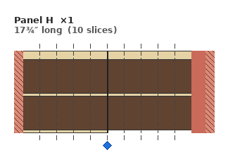

### Slice Fulfillment

**Demand** is every slice the grid places across all 2 finished board(s). **Supplied** is the slices the panels above produce — snipe lost, ripped panels multiplied by their strip count. **Supply Offset** = supplied − demand: negative is a shortfall, positive is extra (ideally non-negative everywhere).

| Slice | Demand | Supplied | Supply Offset |
| --- | --- | --- | --- |
| S-L | 10 × 2 = 20 | 20 | 0 |
| S-R | 10 × 2 = 20 | 20 | 0 |
| ML | 10 × 2 = 20 | 24 | +4 |
| MR | 10 × 2 = 20 | 24 | +4 |
| H-L | 4 × 2 = 8 | 5 × 2 = 10 | +2 |
| H-R | 4 × 2 = 8 | 5 × 2 = 10 | +2 |

_The slice counts supplied are calculated assuming the panels and their quantities are delivered perfectly according to the specs in this section. A panel type may have more than one instance; the ideal panels are always quantity 1._

## 7. Components

**Demand** is what the finished pattern needs (counted from the slice grid; length is the panel the component belongs to). **Fulfilled** is how many the cut list supplies, matched longest-demand-first using exact-length pieces first, then longer pieces cut down (a piece shorter than the demand cannot be used). **Shortfall** is the unmet count. **Total Overcut** is the wasted length trimmed off — the sum of (piece length − demand length) across every longer piece that had to be cut down to fill this row (0 when exact-length pieces covered it).

| Component | Species | Width | Length | Demand | Fulfilled | Shortfall |
| --- | --- | --- | --- | --- | --- | --- |
| C1 | cherry | 1½″ | 15⅞″ | 12 | 12 | 0 |
| C2 | cherry | ¾″ | 15⅞″ | 20 | 20 | 0 |
| M1 | maple | 1½″ | 15⅞″ | 10 | 10 | 0 |
| Md | maple | ¼″ | 17¾″ | 2 | 2 | 0 |
| Md | maple | ¼″ | 15⅞″ | 19 | 19 | 0 |
| Me | maple | ¾″ | 17¾″ | 1 | 1 | 0 |
| Me | maple | ¾″ | 15⅞″ | 11 | 11 | 0 |
| W1 | walnut | 3″ | 17¾″ | 2 | 2 | 0 |
| W2 | walnut | ¾″ | 15⅞″ | 24 | 24 | 0 |

## 8. Panels (profiles and sequence)

The physical panels this plan builds (from the project's panel specs), grouped by identical shape. Qty is how many of each to glue up.

| Panel | Qty | Length | Profiles (slices) | Component sequence |
| --- | --- | --- | --- | --- |
| S | 5 | 15⅞″ | L: 4, R: 4 | Me · C2 · M1 · C2 · Md · C2 · M1 · C2 · Md |
| ML | 3 | 15⅞″ | single: 8 | Me · W2 · C1 · W2 · Md · W2 · C1 · W2 · Md |
| MR | 3 | 15⅞″ | single: 8 | Me · W2 · C1 · W2 · Md · W2 · C1 · W2 |
| H | 1 | 17¾″ | L: 5, R: 5 | Me · W1 · Md · W1 · Md |

## 9. Slice Grid

The final step: arrange the slices into the finished face. The same grid keyed by slice id — each slice is framed in its legend color so you can see how to arrange the grid cell by cell. A corner triangle marks a slice placed horizontally flipped.

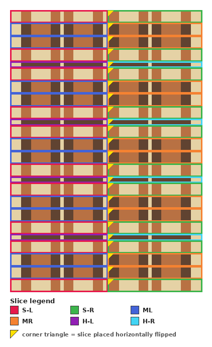
