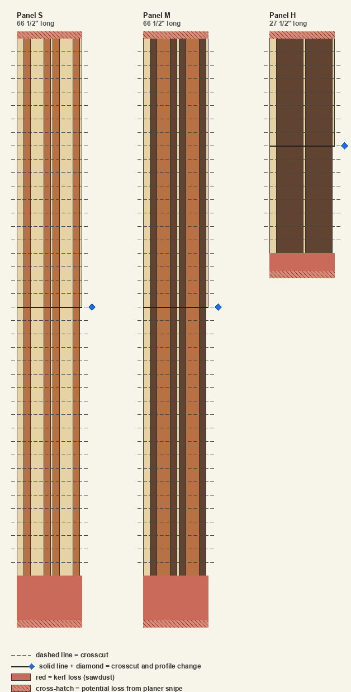

# Plaid v1 — Cut Plan

*Two end-grain plaid cutting boards built from cherry, walnut, and brown maple.*

This is a generated plan: the finished design (sections 1, 2, 4, 5) and the cut list that realizes it on the boards in hand (the Initial board rips section). Where the cut list cannot be met from inventory it calls for **bought boards** — buy those and re-run before cutting.

## 1. Warnings

| # | Lvl | Type | Message |
| --- | --- | --- | --- |
| 1 | 🔴 | crosscut_overflow | Board BW1 is over-cut by 7⁵⁄₁₆″: its blanks demand more length than the raw board has. |
| 2 | 🔴 | crosscut_overflow | Board BW2 is over-cut by 13¹³⁄₁₆″: its blanks demand more length than the raw board has. |
| 3 | 🔴 | over_rip | Cut list for board BC1A over-rips by ¹⁄₁₆″: the strips are wider than the board. |
| 4 | 🔴 | over_rip | Cut list for board BW1A over-rips by ⅛″: the strips are wider than the board. |
| 5 | 🟡 | ghost_boards | 1 board(s) must be bought (not in inventory): GHC. |
| 6 | 🟡 | shortfall | The cut list under-supplies 365 component piece(s) across 9 demand row(s) — see the Components section. |
| 7 | 🟡 | small_margin | Board BC2A leaves only 0″ margin (< ¼″) — too tight; prone to under-supplying strips if the board runs narrow. |
| 8 | 🟡 | small_margin | Board GHC leaves only 0″ margin (< ¼″) — too tight; prone to under-supplying strips if the board runs narrow. |

## 2. Finished board pattern

The finished plaid face.

## 3. Slice Grid

The same grid keyed by slice id: each slice is framed in its legend color so you can see how to arrange the grid cell by cell. A corner triangle marks a slice placed horizontally flipped.

## 4. Panels overview

| Panel | Length | Slices | Height | Ripped | Sequence (outer → in) |
| --- | --- | --- | --- | --- | --- |
| S | 66½″ | 40 (L:20 + R:20) | ¾″ | — | Me · C2 · M1 · C2 · Md · C2 · M1 · C2 · Md |
| M | 66½″ | 40 (L:20 + R:20) | ¾″ | — | Me · W2 · C1 · W2 · Md · W2 · C1 · W2 · Md |
| H | 27½″ | 16 (L:8 + R:8) | ¼″ | 2× (¼″) | Me · W1 · Md · W1 · Md |

## 5. Panel Faces

Each panel drawn to scale with its length running top-to-bottom. Components are vertical stripes aligned on the squared edge; profile regions stack down the length, so the silhouette steps narrower where trailing components drop out. Dashed lines are the slice crosscuts; the solid red band is total kerf loss, and the cross-hatched ends are the snipe tails (possible loss, depending on the planer).

## 6. Crosscut Blanks

The first operation: crosscut each raw inventory board along its length into the labeled board blanks that get ripped later (the Initial board rips section). Boards that start from another board's leftover margin are not raw-stock crosscuts — they appear as the labeled offcuts in the Board Rip Diagram.

| Raw board | Species | Raw length | Blanks (id = length) | Leftover |
| --- | --- | --- | --- | --- |
| BC1 | cherry | 48⅛″ | BC1A = 47¾″ | ⅜″ |
| BC2 | cherry | 48¹⁄₁₆″ | BC2A = 47¾″ | ⁵⁄₁₆″ |
| BW1 | walnut | 54⁵⁄₁₆″ | BW1A = 27½″; BW1B = 34″ | -7⁵⁄₁₆″ (overflow!) |
| BW2 | walnut | 54⁵⁄₁₆″ | BW2A = 34″; BW2B = 34″ | -13¹³⁄₁₆″ (overflow!) |
| BM1 | maple | 98¹⁄₁₆″ | BM1A = 34″; BM1B = 34″ | 29¹⁵⁄₁₆″ |
| BM2 | maple | 47¹⁵⁄₁₆″ | — (untouched spare) | — |

### Crosscut Diagram

Each bar is one raw board drawn to scale by length; segments are the blanks (labeled with id and length inside), reddish stripes are crosscut kerfs (sawdust), and the pale tail is leftover length. A red tail means the blanks overflow the raw board. An untouched spare is shown washed-out and uncut; a board used whole goes straight to the rip diagram.

## 7. Initial board rips (the cut list)

Each row is one physical board at the saw: rip the strips down its width, then crosscut each strip to the piece lengths. The **Board** column shows `id @ width` — the board's width when ripping begins. **Used** is the summed strip width, **Loss** is rip kerf + planer cleanup per strip, **Margin** is the leftover width (negative = the strips do not fit; large = the board is oversized for what it yields).

| Board | Origin | Species | Length | Rips (width × count) | Used | Loss | Margin |
| --- | --- | --- | --- | --- | --- | --- | --- |
| BC1A @ 7¼″ | BC1 | cherry | 47¾″ | 1½″ ×1 · ¾″ ×6 | 6″ | 1⁵⁄₁₆″ | -¹⁄₁₆″ |
| BC2A @ 6¹⁵⁄₁₆″ | BC2 | cherry | 47¾″ | 1½″ ×3 · ¾″ ×2 | 6″ | ¹⁵⁄₁₆″ | 0″ |
| BW1A @ 6¼″ | BW1 | walnut | 27½″ | 3″ ×2 | 6″ | ⅜″ | -⅛″ |
| BW1B @ 6¼″ | BW1 | walnut | 34″ | ¾″ ×4 | 3″ | ¾″ | 2½″ |
| BW2A @ 6¹⁄₁₆″ | BW2 | walnut | 34″ | ¾″ ×4 | 3″ | ¾″ | 2⁵⁄₁₆″ |
| BW2B @ 6¹⁄₁₆″ | BW2 | walnut | 34″ | ¾″ ×4 | 3″ | ¾″ | 2⁵⁄₁₆″ |
| BM1A @ 8⁷⁄₁₆″ | BM1 | maple | 34″ | 1½″ ×2 · ¾″ ×2 · ¼″ ×3 | 5¼″ | 1⁵⁄₁₆″ | 1⅞″ |
| BM1B @ 8⁷⁄₁₆″ | BM1 | maple | 34″ | 1½″ ×2 · ¾″ ×2 · ¼″ ×2 | 5″ | 1⅛″ | 2⁵⁄₁₆″ |
| GHC @ 7⅛″ | *None* | cherry | 34″ | 1½″ ×2 · ¾″ ×4 | 6″ | 1⅛″ | 0″ |

### Board Rip Diagram

Each labeled block below is one physical board. Horizontal bands are the strips ripped down the board's width; within a band, the colored cells are the crosscut pieces (with thin kerf gaps between them) and the lightened tail is the offcut. The pale band under the strips is the leftover margin; a gray title marks a board that must be bought.

## 8. Components

**Demand** is what the finished pattern needs (counted from the slice grid; length is the panel the component belongs to). **Fulfilled** is how many the cut list supplies, matched longest-demand-first using exact-length pieces first, then longer pieces cut down (a piece shorter than the demand cannot be used). **Shortfall** is the unmet count.

| Component | Species | Width | Length | Demand | Fulfilled | Shortfall | Total Overcut |
| --- | --- | --- | --- | --- | --- | --- | --- |
| Me | maple | ¾″ | 66½″ | 40 | 0 | 40 | 0 |
| C2 | cherry | ¾″ | 66½″ | 80 | 0 | 80 | 0 |
| M1 | maple | 1½″ | 66½″ | 40 | 0 | 40 | 0 |
| Md | maple | ¼″ | 66½″ | 60 | 0 | 60 | 0 |
| W2 | walnut | ¾″ | 66½″ | 80 | 0 | 80 | 0 |
| C1 | cherry | 1½″ | 66½″ | 40 | 0 | 40 | 0 |
| Me | maple | ¾″ | 27½″ | 8 | 4 | 4 | 19½″ |
| W1 | walnut | 3″ | 27½″ | 16 | 2 | 14 | 0 |
| Md | maple | ¼″ | 27½″ | 12 | 5 | 7 | 26″ |

**Unused pieces** — produced by the cut list but not attributable to any demand (wrong length for every demand row that needed this component):

| Component | Species | Width | Length | Count |
| --- | --- | --- | --- | --- |
| C1 | cherry | 1½″ | 34″ | 6 |
| C2 | cherry | ¾″ | 34″ | 12 |
| W2 | walnut | ¾″ | 34″ | 12 |
| M1 | maple | 1½″ | 34″ | 4 |

## 9. Panels (profiles and sequence)

| Panel | Length | Profiles (slices) | Component sequence |
| --- | --- | --- | --- |
| S | 66½″ | L: 20, R: 20 | Me · C2 · M1 · C2 · Md · C2 · M1 · C2 · Md |
| M | 66½″ | L: 20, R: 20 | Me · W2 · C1 · W2 · Md · W2 · C1 · W2 · Md |
| H | 27½″ | L: 8, R: 8 | Me · W1 · Md · W1 · Md |

## 10. Plane, slice, and flatten

Glue up each panel, plane to its thickness, then slice crosswise at the slice depth (1½″) with the miter kerf (⅛″) between slices.

**Panel H is ripped, not planed thin:** each sliced piece is ripped into 2 strips of ¼″ (the installed row height), so 16 sliced pieces yield 32 installed slices — saving the costlier wood from being planed to dust.

Finally flatten the end-grain faces to the finished thickness (1¼″); the difference from the slice depth is the whole budget for flattening and misalignment.
